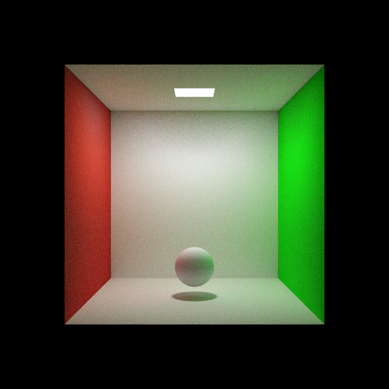
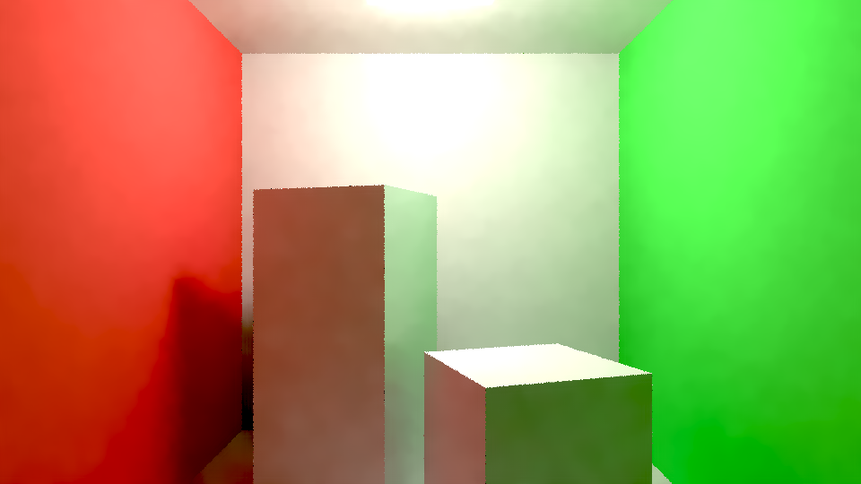
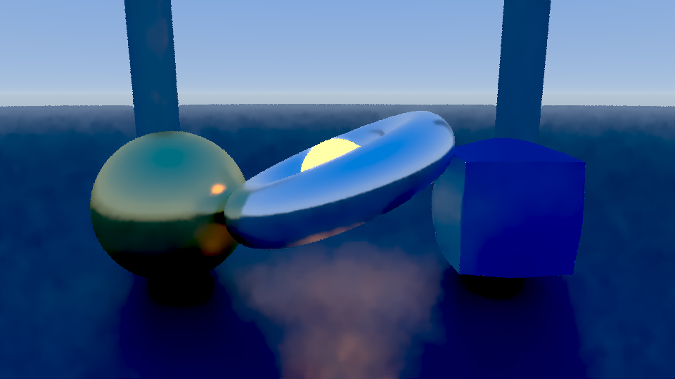
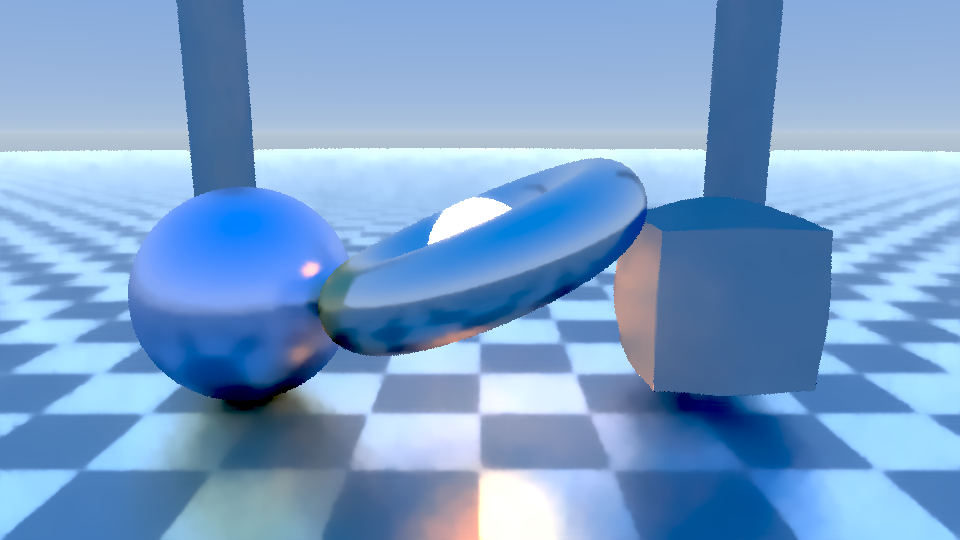
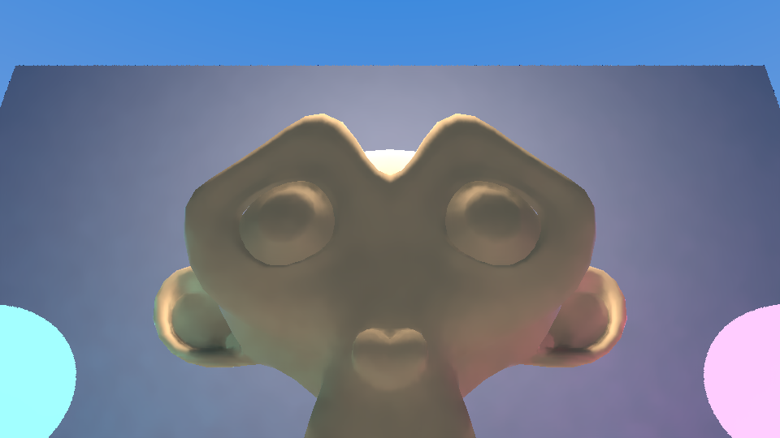
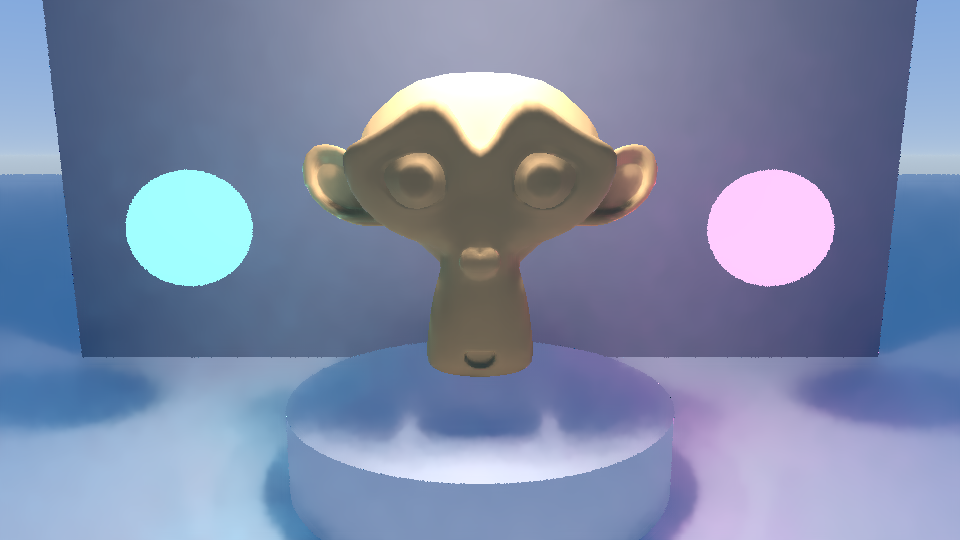

# PORTADA

## Generación acelerada en GPU de campos de distancia con signo (SDF) a partir de mallas poligonales

### Evaluación de técnicas de propagación y aplicación a iluminación global interactiva

**Nombre del estudiante:** Daniel Martí Casanova  
**Programa:** Máster Universitario en Diseño y Programación de Videojuegos  
**Área del trabajo final:** Programación Gráfica y Motores de Videojuegos  
**Tutor/a de TF:** Gonzalo Nicolás Barreales  
**Profesor/a Responsable de la Asignatura (PRA):** Joan Arnedo Moreno  
**Fecha de entrega:** 08/11/2026  

---

# FICHA DEL TRABAJO FINAL

**Título del trabajo:** Generación acelerada en GPU de campos de distancia con signo (SDF) a partir de mallas poligonales

**Nombre del autor:** Daniel Martí Casanova

**Nombre del tutor/a de TF:** Gonzalo Nicolás Barreales

**Nombre del profesor/a responsable de la asignatura (PRA):** Joan Arnedo Moreno

**Fecha de entrega:** 12/2026

**Titulación o programa:** Máster Universitario en Diseño y Programación de Videojuegos

**Área del trabajo final:** Programación Gráfica y Motores de Videojuegos

**Idioma del trabajo:** Castellano

**Palabras clave:** Campos de distancia con signo, generación acelerada en GPU, iluminación global.

## Resumen del trabajo

Este Trabajo Final de Máster propone diseñar, implementar y evaluar dos métodos de generación de campos de distancia con signo (*Signed Distance Fields*, SDF) volumétricos en GPU a partir de mallas poligonales. Estas representaciones permiten realizar consultas de distancia para el trazado de rayos por software, pero su generación puede resultar costosa al aumentar la resolución del volumen y la complejidad de la geometría.

Se desarrollará un método base de cálculo de distancias mediante *compute shaders* y una alternativa que combine la captura de datos de superficie por rasterización con el algoritmo *Jump Flooding* (JFA) en tres dimensiones. El método base se comprobará con geometrías de control antes de utilizarlo como referencia.

Los campos generados se integrarán en un visor interactivo construido a partir de un prototipo previo del autor. El visor permitirá examinar el volumen y observar su aplicación a iluminación indirecta difusa de un rebote, oclusión ambiental y sombras suaves. Su función será apoyar la evaluación, sin constituir un motor gráfico de propósito general.

La comparación analizará el tiempo de generación, el consumo de memoria de vídeo y el error de distancia sobre un conjunto delimitado de escenas. Se espera identificar las ventajas y limitaciones de cada método, sin presuponer una mejora uniforme en todas las condiciones. Esta segunda entrega presenta el estado del arte exhaustivo, la especificación de requisitos y escenas, la formulación matemática y diseño arquitectónico de los generadores de SDF en GPU, y la consolidación e inspección experimental del visor interactivo de validación (Hito OE1).

## Abstract

This master's thesis proposes the design, implementation, and evaluation of two GPU methods for generating volumetric Signed Distance Fields (SDFs) from polygonal meshes. These representations support distance queries for software ray tracing, but their generation can become computationally expensive as volume resolution and geometric complexity increase.

A baseline distance computation method will be implemented using compute shaders. An alternative approach will combine rasterized surface data with the three-dimensional Jump Flooding Algorithm (JFA). The baseline will first be checked against control geometries with known distances before being used as a reference.

The generated fields will be integrated into an interactive viewer adapted from a prototype previously developed by the author. The viewer will support volume inspection and demonstrate one-bounce diffuse indirect lighting, ambient occlusion, and soft shadows. It will serve as an evaluation tool rather than a general-purpose graphics engine.

The experimental comparison will examine generation time, video memory consumption, and distance error across a limited set of test scenes. The aim is to identify the advantages and limitations of each method without assuming consistent improvements under all conditions. This second deliverable presents the comprehensive state of the art, system requirements, mathematical formulation and architecture of the GPU SDF generators, and experimental validation of the interactive testbed (Milestone OE1).

---

# DECLARACIÓN DE RECURSOS UTILIZADOS Y USO DE INTELIGENCIA ARTIFICIAL

## Bibliotecas y tecnologías

El desarrollo utilizará C++ y OpenGL 4.6 como base de la aplicación y de los procesos de renderizado y cálculo en GPU. Se prevé emplear las siguientes bibliotecas:

- **SDL3:** creación de ventanas, gestión del contexto gráfico y tratamiento de eventos de entrada.
- **GLM:** operaciones de álgebra lineal y transformaciones.
- **Assimp:** importación de mallas y escenas tridimensionales.
- **Dear ImGui:** interfaz para modificar parámetros, seleccionar modos de visualización y consultar métricas.

## Modelos y escenas tridimensionales

Se prevé utilizar **Cornell Box** como escena controlada para examinar la iluminación indirecta y las sombras, y **Crytek Sponza** para realizar pruebas con mayor complejidad geométrica y oclusión. Estas escenas se complementarán con modelos geométricos de control.

La selección de las versiones concretas y las adaptaciones necesarias se realizará durante la fase de especificación y diseño, de acuerdo con las condiciones de entrada admitidas por los generadores. Se documentarán la procedencia y las condiciones de uso de los recursos empleados.

## Prototipo previo del autor

El proyecto reutilizará un prototipo propio de *path tracer* interactivo basado en *ray marching* sobre primitivas SDF analíticas y trazado en espacio de pantalla sobre el búfer de profundidad.

Este desarrollo previo servirá como punto de partida del visor. Su adaptación permitirá disponer de un entorno de pruebas antes de integrar los campos volumétricos generados a partir de mallas.

La generación de SDF en GPU, la implementación de la alternativa basada en JFA en tres dimensiones y la evaluación comparativa se desarrollarán durante el TFM. Estas contribuciones se distinguirán de las funcionalidades procedentes del prototipo anterior.

## Uso de herramientas de inteligencia artificial

Se declara el uso de Antigravity / Gemini y OpenAI ChatGPT como apoyo para estructurar la propuesta, redactar y revisar el texto, detectar incoherencias y discutir decisiones técnicas.

La revisión del contenido, la selección de los métodos y la validación de las implementaciones y los resultados serán responsabilidad del autor. Las respuestas de estas herramientas no sustituirán la consulta de las fuentes originales ni la comprobación experimental.

---

# 1. INTRODUCCIÓN

## 1.1. Contexto y justificación del trabajo

La iluminación global en tiempo real plantea un compromiso entre calidad visual y coste de cálculo. Además de la luz que llega directamente desde una fuente hasta una superficie, considera las contribuciones indirectas producidas por las reflexiones sobre otras superficies de la escena, descritas por la ecuación de renderizado [1]. Estas interacciones permiten representar fenómenos como la transferencia de color entre objetos próximos, conocida como *color bleeding* (Figura 1).


Figura 1: Ejemplo de iluminación global: la luz rebota en el suelo e ilumina la parte inferior de la esfera; la luz reflejada en las paredes modula el sombreado de la esfera con el color de cada pared.

En este contexto, los campos de distancia con signo ofrecen una representación de la geometría que puede utilizarse para realizar consultas espaciales durante el trazado de rayos por software. Su aplicación a sistemas de iluminación como Lumen, de Unreal Engine 5 [2], constituye una referencia para estudiar este enfoque. El presente trabajo se centrará en la generación de dichos campos y en una demostración acotada de su uso, sin intentar reproducir un sistema de iluminación de la complejidad de Lumen.

Un campo de distancia con signo, o SDF, representa la distancia mínima desde un punto del espacio hasta la superficie más cercana. El signo permite distinguir el interior del exterior cuando la geometría admite esa clasificación. A partir de esta información, el algoritmo de *sphere tracing* [3] adapta la longitud de los pasos de un rayo según la distancia a la superficie. En una representación volumétrica discretizada, la precisión del campo y los errores de aproximación pueden afectar al trazado y producir artefactos, por lo que su comportamiento debe evaluarse.

La generación del volumen de distancias es uno de los problemas que plantea el uso de SDF a partir de mallas poligonales. El cálculo de distancias entre los puntos de una cuadrícula tridimensional y los triángulos de una malla puede requerir un número elevado de evaluaciones. Su coste depende tanto de la resolución del volumen como de la complejidad de la geometría. Aunque el precálculo puede ser suficiente para determinados usos estáticos, reducir el tiempo de generación permitiría explorar otras condiciones de actualización y uso.

La motivación del proyecto parte de un límite concreto de un prototipo previo del autor: el visor existente utiliza primitivas SDF analíticas. Para trabajar con mallas poligonales, se propone sustituir estas primitivas por texturas tridimensionales que almacenen el campo de distancias. Esta transición proporciona un contexto práctico para estudiar la generación del volumen y observar cómo sus errores afectan al resultado visual.

El trabajo comparará un método base de cálculo de distancias en GPU con una alternativa que combine la captura de datos de superficie mediante rasterización y la propagación espacial mediante *Jump Flooding* (JFA) [4]. La pregunta que orienta la evaluación es qué compromiso ofrece esta alternativa entre tiempo de generación, consumo de memoria y error de distancia respecto al método de referencia.

El producto será un prototipo técnico de generación y evaluación de SDF, acompañado de un visor interactivo, dentro del área de programación gráfica y motores de videojuegos. En el visor se podrá cargar una escena de prueba, seleccionar el campo generado por cada método, inspeccionar cortes del volumen y observar su utilización en la iluminación. La generación de los campos y su comparación constituirán el núcleo del trabajo; el visor actuará como herramienta de demostración y análisis.

## 1.2. Objetivos del trabajo

### Objetivo general

Diseñar, implementar y evaluar dos métodos de generación de campos de distancia con signo en GPU a partir de mallas poligonales, comparando una alternativa basada en rasterización y propagación espacial con un método de referencia, y analizando su tiempo de generación, consumo de memoria y precisión mediante pruebas numéricas y un visor interactivo de iluminación.

### Objetivos específicos

**OE1. Adaptar el visor de partida.** Integrar el prototipo previo del autor en una aplicación modular en C++ con OpenGL 4.6 y SDL3, con controles de cámara, iluminación e interfaz, para disponer de un entorno de pruebas durante el desarrollo.

**OE2. Incorporar el muestreo de campos volumétricos.** Sustituir las primitivas SDF analíticas y el trazado en espacio de pantalla por el muestreo de texturas tridimensionales de distancia, adaptando el *ray marching* para representar iluminación indirecta difusa de un rebote, oclusión ambiental y sombras suaves. El sombreado utilizará también la información de superficie necesaria.

**OE3. Implementar y comprobar el método de referencia.** Desarrollar un generador de distancias volumétricas en GPU mediante *compute shaders*. Antes de utilizar sus resultados como referencia, comprobar su funcionamiento con geometrías de control cuyas distancias sean conocidas.

**OE4. Implementar la alternativa de generación rápida.** Diseñar y desarrollar un método que combine la extracción de datos de superficie mediante rasterización de un G-Buffer con la propagación mediante JFA en tres dimensiones. Se estudiarán la cobertura de la captura, el comportamiento de la propagación y el procedimiento de determinación del signo.

**OE5. Facilitar la inspección y comparación de los campos.** Incorporar un selector entre los volúmenes generados por ambos métodos y modos de visualización para examinar cortes del volumen y componentes de iluminación. La visualización adicional de vóxeles tendrá menor prioridad que estas herramientas.

**OE6. Ejecutar la evaluación experimental.** Diseñar y realizar pruebas sobre modelos geométricos de control y las escenas seleccionadas para comparar el tiempo de generación en milisegundos, el consumo de memoria de vídeo y el error de distancia de la alternativa respecto al método base. Las condiciones de comparación y el procedimiento de medición se concretarán durante la fase de diseño.

### Delimitación del alcance

El trabajo se centrará en dos procedimientos de generación de SDF en GPU: un método de referencia y una alternativa basada en rasterización y JFA. No se plantea desarrollar un generador universal para cualquier tipo de malla ni un motor gráfico de propósito general.

Durante la fase de especificación y diseño se definirán las condiciones de entrada de las mallas, el procedimiento de obtención del signo, la captura de datos de superficie y el protocolo experimental. La selección final de las versiones de Cornell Box y Crytek Sponza dependerá de su adecuación a estas condiciones. Los modelos geométricos de control permitirán comprobar el funcionamiento antes de abordar escenas de mayor complejidad.

El rendimiento del visor se analizará por separado del tiempo de generación del campo. La navegación y la visualización deberán permitir examinar los resultados de forma interactiva, pero no se establece como requisito inicial reconstruir todo el volumen en cada fotograma.

Ante una reducción de alcance, se conservarán los dos generadores, su comprobación numérica, la comparación experimental y una demostración básica de iluminación indirecta difusa de un rebote. La inspección por cortes tendrá prioridad sobre la visualización de vóxeles. También podrán reducirse los controles secundarios de la interfaz y los refinamientos visuales, sin sustituir con ellos el trabajo de evaluación.

## 1.3. Impacto en sostenibilidad, ético-social y de diversidad

### Impacto en sostenibilidad

El proyecto estudiará el uso de recursos computacionales mediante la comparación del tiempo y la memoria necesarios para generar campos de distancia en GPU. Los resultados permitirán identificar en qué condiciones una aproximación basada en propagación resulta ventajosa y qué pérdida de precisión puede introducir.

La implementación se planteará sin depender de extensiones específicas de trazado de rayos acelerado por hardware. No obstante, seguirá requiriendo una GPU compatible con las tecnologías seleccionadas.

El trabajo no incluirá mediciones de consumo energético ni de emisiones. Por tanto, una posible mejora del tiempo de ejecución o del uso de memoria no se presentará como una reducción demostrada del impacto ambiental.

### Impacto ético-social

Se prevé publicar el código y la documentación para facilitar el estudio de los métodos y la reproducción de las pruebas. La documentación describirá los requisitos, las condiciones de reutilización y las limitaciones observadas.

Se mantendrá la atribución de las bibliotecas, modelos y fuentes utilizadas, así como una declaración del uso de asistentes de inteligencia artificial. La utilidad del proyecto para estudiantes y desarrolladores se considerará una contribución potencial, sin atribuirle una reducción demostrada de los costes de producción.

### Impacto en diversidad

El proyecto no contempla recopilar datos demográficos ni realizar estudios con usuarios. Las medidas relacionadas con la diversidad se orientarán a facilitar el acceso al conocimiento mediante una documentación clara y una descripción de los requisitos técnicos.

La necesidad de disponer de una GPU compatible puede limitar el acceso al prototipo. Por ello, no se dará por supuesta su ejecución adecuada en equipos de prestaciones reducidas.

## 1.4. Enfoque y método seguido

El proyecto combinará un marco de investigación, un método de desarrollo del software y un sistema de seguimiento del trabajo.

### Marco de investigación

Se utilizará la metodología de investigación en ciencias del diseño, *Design Science Research Methodology* (DSRM), propuesta por Peffers et al. [5]. Este marco organiza el trabajo alrededor de la construcción y evaluación de un artefacto tecnológico.

En este proyecto, el artefacto principal estará formado por los métodos de generación de campos de distancia en GPU. El visor servirá para demostrar su uso y examinar las consecuencias visuales de los campos obtenidos.

El proceso abarcará la identificación del problema, la definición de objetivos, el diseño y desarrollo, la demostración, la evaluación y la comunicación de resultados. La comparación experimental permitirá contrastar los métodos sin presuponer que la alternativa basada en JFA será superior en todas las métricas o escenas.

### Metodología de producción del software

El desarrollo seguirá un enfoque incremental e iterativo basado en prototipos. Se adaptará primero el visor existente y se incorporará después el muestreo de texturas tridimensionales. Para esta integración inicial se utilizarán volúmenes de prueba, sin esperar a que los generadores a partir de mallas estén terminados.

A continuación, se incorporarán el método base, la alternativa JFA y los modos de inspección. Cada incremento se comprobará con casos reducidos antes de pasar a escenas de mayor complejidad.

Las decisiones de diseño y los problemas encontrados se documentarán durante la implementación. La memoria se redactará de forma progresiva, en lugar de concentrar toda la documentación al final del proyecto.

### Gestión del proyecto

El seguimiento se realizará mediante un tablero Personal Kanban, con tareas vinculadas a los objetivos y a los hitos de entrega. Se revisará semanalmente el avance para detectar bloqueos, actualizar prioridades y registrar las desviaciones respecto a la planificación.

Git se utilizará para el control de versiones y la trazabilidad de los cambios, siguiendo la convención *Conventional Commits*. Las revisiones con el tutor permitirán contrastar el alcance y orientar las decisiones que afecten a la viabilidad del trabajo.

### Distribución del trabajo entre entregas

**PEC 1. Definición y planificación.** Se concretarán el problema, la motivación, los objetivos, el alcance y la planificación inicial. Esta entrega no incluirá nueva implementación del proyecto.

**PEC 2. Estudio, diseño y entorno de validación.** Se desarrollarán el estado del arte, los requisitos, la arquitectura de los generadores y el protocolo experimental. En el plano práctico, se consolidará y verificará el visor interactivo con filtrado SVGF (OE1) y se integrará el muestreo de texturas 3D mediante volúmenes de control generados por un *compute shader* preliminar (avance de OE2), despejando los riesgos de integración antes de abordar la geometría poligonal.

**PEC 3. Implementación de generadores volumétricos a partir de mallas.** Se implementarán la carga y empaquetado de mallas en búferes SSBO, el generador base de referencia punto-triángulo (OE3), el generador alternativo basado en captura de superficie y propagación JFA 3D (OE4) y el inspector de cortes bidimensionales (OE5). Se realizarán las primeras comprobaciones numéricas y mediciones comparativas, actualizando el capítulo 4.

**PEC 4. Evaluación y cierre.** Se completará la batería experimental, se analizarán los resultados y se redactarán las conclusiones. También se consolidará la memoria y se preparará la presentación y defensa en vídeo.

## 1.5. Planificación del trabajo

### Recursos necesarios

**Hardware.** Se prevé utilizar una estación de trabajo con procesador multinúcleo x86-64, al menos 16 GB de memoria RAM y una tarjeta gráfica dedicada compatible con OpenGL 4.6, *compute shaders* y texturas tridimensionales con acceso mediante *shader image load/store*. Las resoluciones de trabajo se ajustarán a la memoria disponible y a los resultados de las pruebas.

**Software y entorno de desarrollo.** Se utilizará GNU/Linux, un compilador compatible con C++20 —GCC o Clang—, CMake 3.20 o superior y Visual Studio Code. RenderDoc y las herramientas de monitorización de GPU servirán para inspeccionar recursos y analizar el comportamiento de la aplicación.

**Bibliotecas.** La aplicación utilizará SDL3, GLM, Assimp y Dear ImGui para la gestión de ventanas y entrada, las operaciones matemáticas, la importación de mallas y la interfaz.

**Modelos de prueba.** Se emplearán geometrías de control y las versiones seleccionadas de Cornell Box y Crytek Sponza, en formatos compatibles con el importador, como OBJ o glTF.

### Dedicación y seguimiento

La planificación se elaborará a partir de una dedicación estimada de **20 horas semanales** (correspondiente a los 12 créditos ECTS de la asignatura, con un total estimado de 300 horas distribuidas a lo largo del semestre), que incluirá investigación, desarrollo, pruebas, documentación y revisión de las entregas.

La implementación principal se concentrará en el periodo correspondiente a la PEC 3. La documentación se mantendrá durante todas las fases, y la preparación del procedimiento de medición deberá quedar avanzada antes de comenzar la batería experimental final.

La disponibilidad durante el periodo final se tendrá en cuenta al concretar la dedicación. La entrega final de la PEC 4 se realizará el 23 de diciembre de 2026, concluyendo el trabajo antes del receso navideño. Si fuera necesario resolver incidencias durante la recta final, se ajustará el número de configuraciones experimentales secundarias, preservando la validez de la comparación principal entre los dos métodos.

El seguimiento semanal permitirá contrastar el trabajo realizado con el previsto y justificar las modificaciones del calendario.

### Hitos por PEC

**PEC 1 — 11/10/2026: definición del proyecto e introducción.**

Se completarán la ficha del trabajo y el capítulo 1 de la memoria, con la justificación, los objetivos, el impacto, la metodología y la planificación. También se organizarán el repositorio y la documentación inicial.

**PEC 2 — 08/11/2026: estado del arte, arquitectura y consolidación del visor base.**

Se redactarán el capítulo 2 (estado del arte) y el capítulo 3 (requisitos, escenas y protocolo experimental). En el capítulo 4 se definirá la arquitectura de los generadores en GPU y se documentará la implementación y verificación del visor interactivo híbrido con reducción de ruido SVGF (OE1), junto con la integración preliminar de texturas 3D (`GL_TEXTURE_3D`) mediante volúmenes analíticos de prueba en *compute shaders* (avance de OE2).

**PEC 3 — 29/11/2026: implementación de generadores sobre mallas y resultados intermedios.**

Se sustituirá el generador procedimental de prueba por la lectura de mallas poligonales en GPU mediante búferes SSBO, implementando el generador base de referencia (OE3) y la alternativa acelerada mediante rasterización y JFA 3D (OE4). Se incorporará el visor de cortes ortogonales 2D (OE5) y se conectarán los volúmenes generados con el trazador de iluminación (consolidación de OE2). La entrega incluirá las primeras comprobaciones numéricas y mediciones comparativas.

**PEC 4 — 23/12/2026: resultados, memoria final y defensa.**

Se completarán las pruebas, el análisis del capítulo 5 y las conclusiones del capítulo 6. Se revisará el diseño documentado y se consolidará la memoria. La presentación y la grabación de la defensa se prepararán antes del margen final de contingencia.

### Cronograma

La Tabla 1 recoge la planificación actualizada del proyecto. Durante la fase correspondiente a la PEC 2 se ha adelantado la consolidación del visor interactivo (OE1) y la transición inicial a texturas 3D mediante volúmenes de control generados en GPU (OE2 preliminar). Esta adaptación temprana mitiga el riesgo de integración visual (R2) y permite dedicar íntegramente el bloque de la PEC 3 a la implementación y validación de los dos generadores a partir de mallas poligonales (OE3 y OE4) y al inspector de cortes (OE5).

**Tabla 1. Cronograma del proyecto.**

| Fase  | Actividad                                                                        | Inicio     | Fin        |
| ----- | -------------------------------------------------------------------------------- | ---------- | ---------- |
| PEC 1 | Definición del proyecto y ficha del trabajo                                      | 23/09/2026 | 06/10/2026 |
| PEC 1 | Redacción del capítulo 1 y preparación de la entrega                             | 06/10/2026 | 11/10/2026 |
| PEC 2 | Investigación y redacción del estado del arte                                    | 12/10/2026 | 25/10/2026 |
| PEC 2 | Consolidación del visor híbrido SVGF y verificación determinista (OE1)           | 15/10/2026 | 28/10/2026 |
| PEC 2 | Especificación de requisitos y protocolo de evaluación                           | 23/10/2026 | 01/11/2026 |
| PEC 2 | Diseño arquitectónico de generadores e integración 3D preliminar (OE2)           | 28/10/2026 | 08/11/2026 |
| PEC 3 | Empaquetado de mallas (Assimp/SSBO) e implementación del generador base (OE3)    | 09/11/2026 | 16/11/2026 |
| PEC 3 | Implementación del generador alternativo por captura superficial y JFA 3D (OE4)  | 15/11/2026 | 23/11/2026 |
| PEC 3 | Implementación del visor de cortes 2D y conexión de mallas con el trazador (OE5) | 21/11/2026 | 26/11/2026 |
| PEC 3 | Comprobaciones numéricas iniciales, primeras mediciones y entrega PEC 3          | 24/11/2026 | 29/11/2026 |
| PEC 4 | Batería experimental final y recogida de datos                                   | 30/11/2026 | 08/12/2026 |
| PEC 4 | Análisis de resultados y discusión                                               | 07/12/2026 | 14/12/2026 |
| PEC 4 | Revisión del diseño, conclusiones y consolidación de la memoria                  | 12/12/2026 | 18/12/2026 |
| PEC 4 | Preparación de la presentación y grabación de la defensa                         | 17/12/2026 | 20/12/2026 |
| PEC 4 | Margen de contingencia y comprobación final de los entregables                   | 21/12/2026 | 23/12/2026 |

*Fuente: elaboración propia.*

La entrega final está prevista para el 23 de diciembre de 2026. El margen de contingencia no se considerará tiempo disponible para añadir funcionalidades nuevas, sino una reserva para resolver incidencias y corregir los entregables.

### Riesgos y medidas de mitigación

La Tabla 2 recoge los principales riesgos técnicos y organizativos. Las valoraciones de probabilidad e impacto son iniciales y se revisarán conforme avance el proyecto.

**Tabla 2. Riesgos y estrategias de mitigación.**

| ID | Riesgo | Probabilidad | Impacto | Mitigación y contingencia |
| --- | --- | --- | --- | --- |
| R1 | Consumo excesivo de memoria de vídeo por los volúmenes y las estructuras auxiliares. | Media | Alto | Parametrizar la resolución, utilizando inicialmente tamaños exploratorios como 64³, 128³ y 256³. Estudiar formatos como `GL_R16F` y `GL_R32F` y contabilizar también los recursos temporales utilizados durante la generación. |
| R2 | Rendimiento insuficiente para utilizar el visor de forma interactiva. | Media | Medio | Medir por separado el renderizado y la generación del campo. Ajustar el número de pasos de trazado, los criterios de parada y la resolución de cálculo de la iluminación indirecta. |
| R3 | Cobertura incompleta de la geometría, errores de distancia o fallos en la determinación del signo. | Alta | Alto | Comenzar con mallas de control simples y cerradas. Examinar por separado la captura, la distancia y el signo, y distinguir los errores del campo de los artefactos introducidos por el renderizado. Concretar las correcciones durante el diseño y la implementación. |
| R4 | Dificultades en la implementación de JFA en tres dimensiones. | Media | Alto | Desarrollar y comprobar la propagación en casos reducidos antes de integrarla con escenas completas. Contrastar los resultados esperados para distinguir los fallos de implementación del error de aproximación del método. |
| R5 | Retrasos respecto a los hitos de entrega. | Media | Alto | Revisar semanalmente el avance. Proteger los dos generadores, las comprobaciones numéricas, la comparación experimental y la demostración básica de iluminación. Reducir primero la visualización de vóxeles, los controles secundarios y los refinamientos visuales. |

*Fuente: elaboración propia.*

Las medidas de contingencia darán prioridad a obtener resultados comparables y documentados. Una demostración visual más completa no compensará la ausencia de comprobaciones o de datos suficientes para evaluar los métodos.

## 1.6. Breve sumario de productos obtenidos

En esta segunda entrega se consolidan los fundamentos teóricos, la especificación técnica y los diseños arquitectónicos de los componentes previstos, junto con la culminación del primer hito práctico (OE1):

### Aplicación interactiva de pruebas y validación (Hito OE1 completado)

Se ha desarrollado una aplicación modular en C++20 y OpenGL 4.6 Core Profile que gestiona ventanas y eventos con SDL3, interfaz gráfica con Dear ImGui y un cauce de renderizado diferido con reducción de ruido espacio-temporal SVGF. Este entorno sirve como banco de pruebas validado para la futura inyección de volúmenes SDF.

### Módulos de generación de SDF en GPU (Hitos OE3 y OE4 diseñados)

Se han formalizado matemáticamente y diseñado a nivel de arquitectura GPU dos módulos de cálculo volumétrico: el método base de referencia mediante *compute shaders* (evaluación directa punto-triángulo) y la alternativa rápida mediante rasterización de superficie y propagación por *Jump Flooding* (JFA) 3D.

### Sistema de iluminación e inspección volumétrica

El visor dispone de un trazador de caminos híbrido con soporte para muestreo volumétrico, sombras suaves cónicas, oclusión y un visor de cortes ortogonales bidimensionales (*slice viewer*) para inspeccionar la distribución del campo de distancias escalar.

### Banco de pruebas y protocolo de evaluación

Se han definido las escenas canónicas de control geométrico (esfera y cubo analíticos) y las escenas arquitectónicas (Cornell Box y Crytek Sponza), junto con la formulación analítica de métricas de error (MAE, RMSE, $E_{\max}$), consumo de VRAM y tiempos de cálculo aislados mediante consultas `GL_TIME_ELAPSED`.

### Memoria y documentación académica

Se presenta la memoria técnica reestructurada según la normativa de la UOC para la PEC 2, documentando el estado del arte, los materiales y métodos, la arquitectura detallada y las validaciones cuantitativas del visor de partida.

## 1.7. Breve descripción de los otros capítulos de la memoria

### Capítulo 2. Estado del arte

Presenta los fundamentos matemáticos de los campos de distancia con signo (SDF) y la ecuación iconal. Desarrolla exhaustivamente la formulación de distancia mínima punto-triángulo en GPU y los métodos topológicos de determinación de signo. Profundiza en el algoritmo *Jump Flooding* (JFA) 3D y contextualiza las técnicas de iluminación global y reconstrucción espacio-temporal (SVGF) como herramientas de validación visual.

### Capítulo 3. Materiales y métodos

Define los requisitos funcionales y no funcionales del sistema, desglosando la generación volumétrica y el visor interactivo. Detalla la pila tecnológica, la caracterización de las escenas canónicas y los modelos de control, y formaliza el protocolo experimental dual (validación del visor en Fase 1 y evaluación comparativa de generadores en Fase 2).

### Capítulo 4. Diseño e implementación

Expone la arquitectura general del sistema en GPU, detallando el empaquetado de geometrías en SSBOs y el cauce *compute shader* de los generadores (OE3 y OE4). Asimismo, documenta de forma íntegra la implementación del visor interactivo híbrido y el filtro SVGF (OE1), acompañada de su validación experimental en tasas de refresco y estabilidad numérica.

### Capítulo 5. Resultados

Presenta la plantilla estructural para la consolidación de los ensayos experimentales que se llevarán a cabo en las entregas PEC 3 y PEC 4, estructurada en comprobación de control, tiempos de GPU, consumo de memoria VRAM, error métrico de distancias e impacto visual en iluminación global.

### Capítulo 6. Conclusiones y trabajo futuro

Resume el grado de cumplimiento de los hitos fijados para la PEC 2 (consecución de OE1, OE5 y diseño de OE3/OE4), estableciendo la hoja de ruta de implementación inmediata para la PEC 3 y las líneas de investigación futura para la PEC 4.

### Capítulo 7. Glosario

Define los términos y acrónimos fundamentales empleados a lo largo del documento (SDF, JFA, SVGF, SSBO, Compute Shader, Voxelización, G-Buffer, etc.).

### Capítulo 8. Bibliografía

Recoge las fuentes académicas y técnicas citadas a lo largo de la memoria mediante numeración correlativa estandarizada conforme al formato IEEE.

### Capítulo 9. Anexos

Contiene las especificaciones estructurales de los módulos de sombreado GLSL y las instrucciones reproducibles de compilación y ejecución en entornos compatibles.

---

# 2. ESTADO DEL ARTE

## 2.1. Campos de distancia con signo (SDF) y trazado de esferas

Un campo de distancia con signo (*Signed Distance Field*, SDF) es una función escalar $f: \mathbb{R}^3 \to \mathbb{R}$ que asigna a cada coordenada espacial la distancia euclídea mínima a la superficie delimitadora más próxima $\partial \mathcal{S}$ de la escena:

$$f(p) = \text{sign}(p) \cdot \min_{q \in \partial \mathcal{S}} \|p - q\|$$

El signo positivo identifica los puntos pertenecientes al exterior del volumen, el valor cero define la superficie geométrica $\partial \mathcal{S}$, y el signo negativo determina el interior de cuerpos cerrados y orientables. La propiedad matemática fundamental de un campo de distancia continuo es que satisface la ecuación iconal $\|\nabla f(p)\| = 1$ en casi todo el dominio continuo. Esto garantiza que la magnitud del gradiente espacial coincide con la unidad y que su vector normalizado corresponde con el vector normal unitario a la superficie:

$$n = \nabla f(p) = \left( \frac{\partial f}{\partial x}, \frac{\partial f}{\partial y}, \frac{\partial f}{\partial z} \right)$$

Esta característica fundamenta el algoritmo de trazado de esferas (*Sphere Tracing*) introducido por Hart [3]. A diferencia del trazado por pasos uniformes (*ray marching* regular), el trazado de esferas garantiza que dentro de una esfera de radio $f(p)$ centrada en la posición actual del rayo no existe intersección geométrica alguna con la escena. Por tanto, el avance del rayo puede adaptarse dinámicamente a la distancia devuelta por el campo:

$$p_{k+1} = p_k + f(p_k) \cdot \omega$$

Esta aceleración reduce drásticamente el número de evaluaciones necesarias para encontrar una intersección, facilitando tanto el cálculo de sombras suaves cónicas mediante la monitorización del cociente $\min(f(p)/t)$ como el cálculo de rebotes indirectos difusos y oclusión ambiental. En la industria del videojuego, motores de última generación como Unreal Engine 5 con su subsistema Lumen [2] emplean campos de distancia discretizados para realizar consultas de oclusión e iluminación indirecta independientes de la aceleración por hardware dedicada.

## 2.2. Generación de SDF volumétricos en GPU a partir de mallas poligonales

A diferencia de las primitivas analíticas (esferas, cilindros, cajas) cuyas funciones SDF se evalúan mediante expresiones algebraicas cerradas de coste constante $\mathcal{O}(1)$, las mallas poligonales arbitrarias compuestas por $N_{\text{tris}}$ triángulos requieren procedimientos de discretización espacial sobre cuadrículas volumétricas tridimensionales de resolución $V_x \times V_y \times V_z = V^3$ vóxeles.

### Formulación matemática de la distancia mínima punto-triángulo en $\mathbb{R}^3$

Dado un punto de consulta $p \in \mathbb{R}^3$ (correspondiente al centro espacial de un vóxel) y un triángulo tridimensional $T$ definido por sus tres vértices ordenados $\{v_0, v_1, v_2\}$, los vectores directores de sus aristas se expresan como $e_0 = v_1 - v_0$ y $e_1 = v_2 - v_0$. El vector normal no normalizado al plano que contiene al triángulo viene dado por el producto vectorial $n_T = e_0 \times e_1$.

El cálculo de la distancia euclídea mínima entre $p$ y el triángulo $T$, denotada como $d(p, T) = \min_{q \in T} \|p - q\|$, no puede resolverse simplemente calculando la distancia ortogonal al plano infinito que lo contiene, ya que la proyección ortogonal del punto puede quedar fuera de los límites geométricos del triángulo [13]. Siguiendo la formulación geométrica de regiones de Voronoi planares, el triángulo delimita siete regiones disjuntas en el espacio: la cara interior, tres aristas y tres vértices.

La parametrización de cualquier punto sobre el plano del triángulo se define en coordenadas baricéntricas o afines como:

$$q(u, v) = v_0 + u \, e_0 + v \, e_1, \quad \text{con } u \ge 0, \; v \ge 0, \; u + v \le 1$$

Definiendo el vector de desplazamiento $w = v_0 - p$, la distancia al cuadrado entre $p$ y cualquier punto $q(u, v)$ constituye una función cuadrática:

$$\phi(u, v) = \|q(u, v) - p\|^2 = a u^2 + 2 b u v + c v^2 + 2 d u + 2 e v + f$$

donde los coeficientes escalares resultan de los productos escalares fundamentales: $a = e_0 \cdot e_0$, $b = e_0 \cdot e_1$, $c = e_1 \cdot e_1$, $d = e_0 \cdot w$, $e = e_1 \cdot w$ y $f = w \cdot w$. El mínimo global no restringido de esta parábola sobre el plano infinito ocurre en el punto crítico donde el gradiente se anula:

$$u^* = \frac{b e - c d}{a c - b^2}, \quad v^* = \frac{b d - a e}{a c - b^2}$$

A partir de este punto crítico, se discriminan los casos geométricos:

1. **Región de cara:** Si $u^* \ge 0$, $v^* \ge 0$ y $u^* + v^* \le 1$, la proyección ortogonal de $p$ recae estrictamente dentro del triángulo. El punto más próximo es $q = q(u^*, v^*)$ y la distancia mínima coincide con la distancia perpendicular al plano: $d(p, T) = |(p - v_0) \cdot (n_T / \|n_T\|)|$.
2. **Regiones de aristas (3 regiones):** Si la proyección cae fuera de una de las aristas del triángulo pero dentro de los planos delimitadores de sus vértices extremos, el punto más cercano se ubica sobre el segmento de línea que define dicha arista. La solución se reduce a la proyección unidimensional acotada con parámetro $t \in [0, 1]$ sobre el segmento correspondiente.
3. **Regiones de vértices (3 regiones):** Si la proyección cae en el cono exterior de Voronoi adyacente a uno de los vértices, el punto más cercano es unívocamente dicho vértice $v_i$, cumpliéndose $d(p, T) = \|p - v_i\|$.

### Paralelización masiva en GPU mediante Compute Shaders

Para generar un volumen de distancias sobre una cuadrícula regular de $V^3$ vóxeles inscrita en una caja envolvente alineada con los ejes (*Axis-Aligned Bounding Box*, AABB), el método directo o de fuerza bruta asigna un hilo de ejecución independiente a cada vóxel $(i, j, k)$. La posición tridimensional del centro del vóxel en espacio de mundo se calcula como:

$$p_{ijk} = \text{AABB}_{\min} + \left( \frac{(i, j, k) + 0.5}{V} \right) \odot (\text{AABB}_{\max} - \text{AABB}_{\min})$$

En una implementación directa, cada hilo recorre secuencialmente los $N_{\text{tris}}$ triángulos de la malla poligonal, almacenados en un búfer de almacenamiento en GPU (*Shader Storage Buffer Object*, SSBO), evaluando la distancia mínima y conservando el valor escalar más reducido:

$$d(p_{ijk}) = \min_{m \in \{1, \dots, N_{\text{tris}}\}} d(p_{ijk}, T_m)$$

La complejidad computacional global de este enfoque es de $\mathcal{O}(V^3 \cdot N_{\text{tris}})$. Para resoluciones típicas como $128^3$ ($2.097.152$ vóxeles) y mallas con $250.000$ triángulos, el algoritmo exige ejecutar más de $5 \times 10^{11}$ pruebas punto-triángulo. Aunque esta carga computacional limita la interactividad en mallas complejas, su naturaleza masivamente paralela y exenta de divergencias de ramas complejas lo convierte en el método de referencia determinista óptimo para verificar la corrección geométrica de otros algoritmos aproximados.

### Determinación del signo: mallas cerradas frente a mallas arbitrarias

Asignar un signo escalar a la distancia euclídea ($+d$ para el exterior y $-d$ para el interior) requiere determinar la topología del objeto. En computación gráfica se distinguen fundamentalmente dos escenarios:

1. **Mallas 2-variedad cerradas (*watertight / 2-manifold*):** Objetos perfectamente estancos, orientables, sin auto-intersecciones ni aristas compartidas por más o menos de dos caras poligonales. En estas geometrías existe una frontera inequívoca entre el volumen interno y el espacio exterior.
2. **Mallas abiertas o no-variedad (*open boundaries / soup of polygons*):** Modelos comunes en entornos interactivos que contienen planos de grosor nulo, huecos geométricos, caras interiores parásitas o discontinuidades en las normales de los vértices.

Para discernir la pertenencia interior/exterior sobre la cuadrícula volumétrica se estudian tres estrategias principales en la literatura:

- **Pseudo-normales ponderadas por ángulo (*Angle-Weighted Pseudonormals*):** Introducido por Bærentzen y Aanæs [11], este método asocia a cada primitiva geométrica (caras, aristas y vértices) un vector normal regularizado. Para una cara, se emplea su normal geométrica $n_F$. Para un vértice $v$, la pseudo-normal $n_v$ se define como la suma ponderada de las normales de las caras adyacentes multiplicadas por el ángulo interior de apertura $\theta_k$ de cada cara en dicho vértice:
  $$n_v = \sum_{k \in \mathcal{F}(v)} \theta_k \, n_{F_k}$$
  De igual forma, para una arista compartida por dos caras se suman sus normales ponderadas. Cuando un vóxel determina cuál es la característica más cercana (cara, arista o vértice), el signo se calcula mediante el producto escalar entre el vector de desplazamiento al punto más cercano $q$ y la pseudo-normal asociada $n_q$:
  $$\text{sign}(p) = \text{sign}\left( (p - q) \cdot n_q \right)$$
  Este método es sumamente eficiente y de cómputo puramente local, pero resulta vulnerable si la malla no es estrictamente estanca o presenta caras invertidas, provocando inversiones de signo espurias que se propagan a través de las aperturas.
- **Conteo de intersecciones por trazado de rayos (*Ray Casting Parity Count*):** Basado en el teorema de la curva de Jordan generalizado a $\mathbb{R}^3$, se traza un rayo en una dirección arbitraria (por ejemplo, a lo largo del eje $+X$) desde el vóxel $p$ hacia el infinito. Si el número de intersecciones con los triángulos de la escena es impar, el punto es interior; si es par, es exterior. Su mayor inconveniente en GPU radica en el elevado coste de trazar $V^3$ rayos y en la inestabilidad numérica producida cuando un rayo incide tangencialmente sobre una arista o vértice compartido, además de fallar categóricamente en mallas abiertas con huecos.
- **Números de enrollamiento generalizados (*Generalized Winding Numbers*):** Propuesto por Jacobson et al. [12], generaliza el concepto topológico de índice de enrollamiento a mallas poligonales arbitrarias con agujeros, auto-intersecciones y ruido geométrico. El número de enrollamiento $w(p)$ en un punto $p$ se define como la integral del ángulo sólido subtendido por la superficie orientada:
  $$w(p) = \frac{1}{4\pi} \sum_{m=1}^{N_{\text{tris}}} \Omega_m(p)$$
  donde $\Omega_m(p)$ representa el ángulo sólido con signo subtendido por el triángulo $m$ visto desde $p$. Para mallas estancas, $w(p) = 1$ en el interior y $w(p) = 0$ en el exterior. En mallas imperfectas con bordes abiertos o geometrías desconectadas, $w(p)$ adopta valores intermedios que decaen suavemente, permitiendo clasificar el interior mediante un umbral de decisión robusto (típicamente $w(p) \ge 0.5$). Su evaluación directa requiere una complejidad $\mathcal{O}(V^3 \cdot N_{\text{tris}})$, requiriendo aproximaciones jerárquicas tipo Barnes-Hut para su aceleración.

## 2.3. Propagación espacial mediante Jump Flooding Algorithm (JFA) en 3D

Para superar el cuello de botella computacional $\mathcal{O}(V^3 \cdot N_{\text{tris}})$ inherente a los métodos de cálculo directo, se recurre a técnicas de propagación espacial en cuadrículas regulares. El algoritmo *Jump Flooding Algorithm* (JFA), formulado originalmente por Rong y Tan [4], permite calcular transformadas de distancia euclídea discretas (*Discrete Euclidean Distance Transform*, EDT) y aproximaciones de diagramas de Voronoi en arquitecturas masivamente paralelas con una complejidad temporal de $\mathcal{O}(V^3 \log_2 V)$, totalmente independiente del número de triángulos originales de la malla.

### Estructura y fases del cauce JFA en tres dimensiones

La adaptación de JFA a un volumen tridimensional se estructura en tres etapas secuenciales de procesamiento en GPU:

1. **Extracción e inicialización de semillas (*Seed Initialization*):**
   Se analiza la superficie de la malla poligonal sobre la cuadrícula tridimensional mediante rasterización volumétrica conservativa o mediante voxelización superficial directa en *compute shaders*. Para cada vóxel que contenga o intercepte un elemento de superficie, se registra su posición espacial tridimensional en una textura volumétrica de semillas (`GL_RGBA32F` o `GL_RGBA16F`). Los vóxeles vacíos que no intersecan la superficie se inicializan con un valor nulo o un marcador centinela fuera del rango de coordenadas (por ejemplo, $(-1, -1, -1)$).
2. **Pasadas iterativas de salto (*Jump Passes*):**
   Para una resolución cúbica de lado $V$ (donde $V$ es una potencia de dos, tal como 64, 128 o 256), el algoritmo ejecuta $M = \log_2 V$ pasadas sucesivas. En cada iteración $s \in \{0, 1, \dots, M-1\}$, se define una longitud de paso o salto $k$ que se reduce a la mitad en cada paso:
   $$k = \frac{V}{2^{s+1}} \in \left\{ \frac{V}{2}, \frac{V}{4}, \dots, 2, 1 \right\}$$
   En cada pasada, cada vóxel $p = (x, y, z)$ del volumen consulta la información de semilla contenida en sus 26 vecinos tridimensionales más su propia posición ($3 \times 3 \times 3 = 27$ muestras en total), desplazados a una distancia espacial de $k$ vóxeles:
   $$\mathcal{N}_k(p) = \left\{ p + k \cdot (\delta_x, \delta_y, \delta_z) \mid \delta_x, \delta_y, \delta_z \in \{-1, 0, 1\} \right\}$$
   Para cada vecino $q \in \mathcal{N}_k(p)$ dentro de los límites del volumen, si $q$ almacena una semilla válida $S(q)$, se evalúa la distancia euclídea $\|p - S(q)\|$. El hilo actual selecciona la semilla $S^*$ que minimice la distancia euclídea al punto $p$ y la escribe en la textura de salida. La sincronización se garantiza mediante un esquema de doble búfer (*ping-pong*), alternando las texturas de lectura y escritura entre pasadas.
3. **Cálculo de distancia final y asignación de signo:**
   Tras concluir la pasada final con longitud de salto unitaria ($k=1$), cada vóxel $p$ dispone de las coordenadas de la semilla superficial más cercana que ha logrado propagarse hasta su posición. En una pasada de finalización, se computa la distancia euclídea $\|p - S^*(p)\| \cdot \Delta x_{\text{vóxel}}$ y se le asocia el signo correspondiente obtenido del módulo de determinación topológica, almacenando la distancia final en una textura escalar volumétrica (`GL_R32F` o `GL_R16F`).

### Análisis de errores de aproximación y variantes ($\text{JFA}+1$, $1+\text{JFA}$)

Aunque JFA exhibe un rendimiento sobresaliente en GPU, no calcula un diagrama de Voronoi estrictamente exacto debido a la naturaleza discreta del muestreo con pasos grandes. En ciertas configuraciones geométricas cóncavas o con características diagonales complejas, una semilla óptima puede quedar "oculta" o eclipsada detrás de semillas intermedias durante las fases de saltos largos ($k = V/2, V/4$), impidiendo que su información alcance a vóxeles que formalmente pertenecen a su celda de Voronoi.

Rong y Tan [4] identificaron y cuantificaron esta tasa de error en espacios discretos. Para mitigar estas imprecisiones sin renunciar a la velocidad en GPU, propusieron variantes de compensación:

- **Variante $\text{JFA}+1$:** Consiste en ejecutar una pasada adicional con tamaño de salto $k=1$ inmediatamente después de finalizar la secuencia regular. Esta iteración suplementaria permite a los vóxeles corregir discontinuidades locales inmediatas en los bordes de Voronoi, reduciendo el error a una fracción casi nula del volumen total.
- **Variante $1+\text{JFA}$:** Consiste en anteponer una pasada con salto $k=1$ al inicio de la secuencia logarítmica (antes de $k = V/2$), garantizando que las semillas adyacentes de alta curvatura formen un frente continuo antes de proyectarse a grandes distancias.

En el contexto de este proyecto, la cuantificación experimental de este error de propagación frente al método exacto de *compute shaders* constituye uno de los núcleos de investigación analítica del TFM.

## 2.4. Iluminación global en tiempo real y reconstrucción espacio-temporal

Para evaluar de forma cualitativa y cuantitativa la fidelidad de los campos de distancia con signo generados en GPU, es indispensable observar su comportamiento en consultas continuas de trazado de rayos aplicadas a iluminación global interactiva. La ecuación de renderizado [1] formaliza el equilibrio energético de la luz en un entorno virtual, definiendo la radiancia saliente $L_o(p, \omega_o)$ desde un punto $p$ hacia la dirección $\omega_o$ como la suma de la radiancia propia emitida $L_e$ y la integral de la radiancia incidente $L_i$ modulada por la función de distribución de reflectancia bidireccional (BRDF) $f_r$ y el factor geométrico del coseno:

$$L_o(p, \omega_o) = L_e(p, \omega_o) + \int_{\Omega} f_r(p, \omega_i, \omega_o) \, L_i(p, \omega_i) \, (\omega_i \cdot n) \, d\omega_i$$

En aplicaciones interactivas a frecuencias de refresco elevadas (60 a 120 FPS), la evaluación estocástica de esta integral mediante trazado de caminos (*Path Tracing*) está restringida a un presupuesto computacional mínimo de una única muestra por píxel (1 SPP, *Sample Per Pixel*). El muestreo a 1 SPP produce una imagen dominada por una varianza estocástica extrema (ruido blanco o granular de alta frecuencia). Si se pretendiera evaluar visualmente el impacto de las discontinuidades geométricas o los errores de un campo SDF sobre una imagen bruta a 1 SPP, el ruido estocástico de Monte Carlo enmascararía por completo cualquier artefacto sutil introducido por la discretización del volumen.

Por esta razón, la arquitectura del TFM integra un cauce de reconstrucción espacio-temporal robusto basado en el algoritmo SVGF (*Spatiotemporal Variance-Guided Filtering*) [6] que filtra la señal luminosa preservando los bordes geométricos mediante cuatro etapas sinérgicas:

1. **Demodulación de albedo:** Desacopla la reflectancia de los materiales respecto a la irradiancia incidente pura ($E = L / \max(\rho, \epsilon)$), permitiendo que el filtro ondicular suavice gradientes luminosos sin difuminar los detalles texturales del material.
2. **Reproyección temporal:** Rastrea los píxeles a través de matrices de transformación históricas y vectores de velocidad, acumulando muestras coherentes a lo largo de fotogramas sucesivos para elevar exponencialmente el recuento efectivo de muestras.
3. **Estimación y seguimiento de varianza:** Evalúa continuamente los momentos estadísticos de la señal luminosa ($\mu_1 = \mathbb{E}[L]$ y $\mu_2 = \mathbb{E}[L^2]$), computando la varianza local $\sigma^2 = \mu_2 - \mu_1^2$ para adaptar dinámicamente la agresividad del filtrado.
4. **Filtrado multiescala À-Trous:** Aplica un filtro espacial separable basado en ondículas [7] sobre un núcleo $B_3$-spline de $5 \times 5$ en múltiples pasadas ping-pong con saltos exponenciales crecientes ($2^i$ píxeles), ponderado por funciones de parada que detectan discontinuidades en normales, distancias planares y varianza local.

Asimismo, la integración de mallas poligonales rasterizadas con geometrías implícitas volumétricas se canaliza mediante una arquitectura diferida híbrida (*Deferred G-Buffer*). La rasterización primaria extrae la visibilidad y atributos de superficie de las mallas, mientras que el trazador de caminos por *sphere tracing* sobre las texturas 3D SDF resuelve la visibilidad de los rebotes secundarios difusos, la oclusión ambiental y las sombras suaves de contacto. Este marco tecnológico desacopla el análisis del volumen respecto a las limitaciones visuales del muestreo estocástico puro.

---

# 3. MATERIALES Y MÉTODOS

## 3.1. Requisitos del sistema

Para guiar el desarrollo de los módulos de generación volumétrica y la adaptación de la infraestructura de visualización, se dividen los requisitos funcionales en dos bloques operativos y se establecen los requisitos no funcionales del sistema:

### Requisitos funcionales: Generación e inspección volumétrica

- **RF1. Carga y normalización de mallas poligonales:** La aplicación debe importar geometrías en formatos estándar (OBJ, glTF) mediante la biblioteca `Assimp`, calculando automáticamente su caja envolvente alineada con los ejes (AABB) y aplicando transformaciones de centrado y escalado uniforme para inscribir la geometría en el volumen de trabajo unitario $[-0.5, 0.5]^3$.
- **RF2. Generación de SDF de referencia en GPU:** El sistema debe incorporar un módulo basado en *compute shaders* de OpenGL 4.6 que calcule la distancia euclídea mínima exacta punto-triángulo en $\mathbb{R}^3$ para cada vóxel de una cuadrícula tridimensional regular, almacenando el resultado en una textura volumétrica 3D (`GL_TEXTURE_3D`).
- **RF3. Generación acelerada por captura superficial y JFA 3D:** El sistema debe implementar un cauce alternativo que capture los datos de la superficie poligonal mediante rasterización o voxelización en GPU y propague las distancias euclídeas mediante pasadas iterativas de *Jump Flooding Algorithm* en tres dimensiones con esquema *ping-pong*.
- **RF4. Inspección interactiva y conmutación de campos:** La interfaz gráfica de usuario debe permitir conmutar en tiempo de ejecución entre el campo volumétrico de referencia y el campo acelerado por JFA, incorporando además un visor de cortes bidimensionales ortogonales (*slice viewer*) en los planos XY, XZ e YZ para inspeccionar la distribución del campo escalar tanto en el exterior como en el interior de la geometría.

### Requisitos funcionales: Visor de validación e iluminación

- **RF5. Cauce híbrido de renderizado:** La aplicación debe rasterizar mallas poligonales a un G-Buffer primario y combinarlas espacialmente con campos de distancia volumétricos mediante trazado de caminos por GPU.
- **RF6. Trazado de caminos en tiempo real:** El sistema debe ejecutar trazado de caminos de 1 muestra por píxel (1 SPP) con cálculo de iluminación directa multi-fuente, sombras suaves cónicas y rebotes indirectos difusos continuos.
- **RF7. Reducción de ruido SVGF:** La canalización debe incorporar demodulación de albedo, reproyección temporal con detección de desoclusión y momentos, y filtrado espacial multiescala À-Trous en 4 pasadas.
- **RF8. Inspección diagnóstica interactiva:** La interfaz gráfica debe permitir seleccionar modos de depuración en tiempo real (imagen final reconstruida, 1 SPP bruto, irradiancia desruidada, varianza calculada, normales y albedo superficial).
- **RF9. Captura y verificación determinista:** El sistema debe soportar un modo de ejecución desatendido sin interfaz gráfica (`--test`) para registrar capturas a disco y calcular métricas cuantitativas reproducibles de estabilidad numérica y brillo medio.

### Requisitos no funcionales

- **RNF1. Estándares abiertos y portabilidad:** Uso estricto de C++20 y OpenGL 4.6 Core Profile sin recurrir a extensiones propietarias cerradas ni a APIs no portables entre fabricantes de tarjetas gráficas.
- **RNF2. Rendimiento interactivo:** El pipeline de reconstrucción y renderizado debe mantener frecuencias de refresco interactivas (>60 FPS en visualización y entre 1.5 y 3.0 ms de tiempo de GPU para el desruidado en hardware de gama media).
- **RNF3. Estabilidad numérica:** Los shaders deben garantizar blindaje absoluto contra indeterminaciones matemáticas, divisiones por cero, vectores nulos y propagación de valores `NaN` o `Inf`.
- **RNF4. Parametrización del consumo de VRAM y memoria:** El sistema debe permitir configurar la resolución de la cuadrícula volumétrica en potencias de dos ($64^3$, $128^3$ y $256^3$ vóxeles), soportar formatos escalares de precisión media (`GL_R16F`) y simple (`GL_R32F`), y optimizar el ciclo de vida de los destinos de renderizado temporales del algoritmo JFA para acotar el consumo de memoria de vídeo.

## 3.2. Pila tecnológica y herramientas utilizadas

La Tabla 3 detalla los componentes de software, bibliotecas de terceros, compiladores y herramientas de diagnóstico empleados a lo largo del desarrollo.

**Tabla 3. Pila tecnológica y entorno de desarrollo.**

| Componente | Versión / Especificación | Propósito en el proyecto |
| --- | --- | --- |
| **Lenguaje de programación** | C++20 (ISO/IEC 14882:2020) | Núcleo del motor, gestión de memoria, estructuras de datos y canalización. |
| **API Gráfica** | OpenGL 4.6 Core Profile / GLSL 4.60 | Ejecución de shaders de computación, FBOs, texturas 3D y canalización diferida. |
| **SDL3** | Versión 3.2.0 | Creación de ventanas, contexto OpenGL, captura de eventos y temporización precisa. |
| **GLAD** | Especificación Core 4.6 | Carga dinámica de punteros a funciones OpenGL en el host. |
| **GLM** | Versión 1.0.1 | Álgebra lineal tridimensional, matrices de transformación, vectores y cuaterniones. |
| **Assimp** | Versión 5.4+ | Importación de mallas tridimensionales (OBJ, glTF), cálculo de normales y AABB. |
| **Dear ImGui** | Versión 1.91.8 | Interfaz gráfica inmediata para control de parámetros, diagnóstico y conmutación. |
| **stb_image / stb_image_write** | Versión 2.30 / 1.16 | Carga de texturas auxiliares y exportación de capturas de pantalla sin pérdida. |
| **RenderDoc** | Versión 1.3x | Depuración gráfica, inspección de texturas 3D, SSBOs y medición de *compute shaders*. |
| **Sistema de compilación** | CMake 3.28+ con Ninja | Configuración multiplataforma y compilación incremental optimizada. |
| **Compilador C++** | GCC 14.2 / Clang 18.1 | Generación de código binario nativo optimizado mediante `-O3`. |
| **Hardware de desarrollo** | AMD Radeon RX 9060 XT (RDNA 4) / Mesa 26.2 | Plataforma de pruebas gráficas y ejecución del pipeline. |

*Fuente: elaboración propia.*

## 3.3. Escenas y modelos de evaluación

El protocolo experimental contempla dos conjuntos diferenciados de geometrías tridimensionales adaptadas a cada fase de evaluación:

### Escenas de verificación del visor base (Hito OE1)

1. **Escena 1 (Cornell Box analítica):** Entorno cerrado clásico compuesto por paredes difusas roja y verde, un panel de iluminación cenital emisor y dos cubos interiores. Permite evaluar de forma unívoca el transporte radiativo de rebote indirecto de color (*color bleeding*) y verificar que el visor no sufra pérdidas de energía ni fugas luminosas en esquinas cóncavas.
2. **Escena 2 (Primitives Showcase):** Escena abierta gobernada por iluminación direccional exterior que combina esferas reflectantes doradas, un toroide metálico liso, operaciones booleanas suaves de unión y columnas sobre un plano infinito de pizarra pulida. Permite contrastar reflexiones especulares y la estabilidad de las discontinuidades geométricas frente al cielo.
3. **Escena 3 (Hybrid Mesh + SDF Playground):** Escena mixta que integra la malla poligonal de Suzanne (rasterizada mediante G-Buffer a 500 triángulos) sobre un pedestal cilíndrico implícito SDF, con orbes emisores y un plano reflectante. Permite certificar el acoplamiento y arbitraje de profundidad entre geometría poligonal clásica y superficies de distancia.

### Modelos y escenas poligonales para la evaluación de generadores SDF (Hitos OE3, OE4 y OE6)

1. **Modelos geométricos de control (Esfera y Cubo poligonales):** Mallas sintéticas cerradas teseladas con resolución poligonal variable ($1.000$ a $20.000$ triángulos) cuyas dimensiones métricas coinciden exactamente con funciones SDF analíticas conocidas en forma cerrada:
   $$f_{\text{esfera}}(p) = \|p\| - r, \quad f_{\text{cubo}}(p) = \|\max(|p| - b, 0)\| + \min(\max(|p| - b), 0)$$
   Estas geometrías permiten verificar numéricamente la corrección y precisión absoluta del generador base de *compute shaders* antes de utilizar sus salidas como referencia.
2. **Cornell Box poligonal:** Versión discretizada en 32 triángulos de la caja de Cornell tradicional. Proporciona una escena estanca con oclusiones controladas y ángulos rectos que permite contrastar la exactitud de los generadores en ángulos vivos interiores y evaluar la propagación de signos.
3. **Crytek Sponza:** Escena arquitectónica histórica ampliamente adoptada en computación gráfica, compuesta por aproximadamente $262.000$ triángulos distribuidos en múltiples arcos, columnas y detalles de oclusión fina. Permite estresar la escalabilidad temporal y el consumo de VRAM de los generadores ante densidades geométricas elevadas.

## 3.4. Protocolo experimental y metodología DSRM

Siguiendo las directrices del marco DSRM [5], la evaluación experimental se estructura en dos fases secuenciales:

### Fase 1: Validación del banco de pruebas visual (Hito OE1 completado)

La infraestructura de visualización e inspección se somete a un protocolo de verificación dual:

- **Inspección interactiva cualitativa:** Navegación libre mediante cámara orbital y en primera persona, monitorizando la presencia de ebullición temporal (*boiling*), estelas de movimiento (*ghosting*) en desoclusiones violentas y fidelidad de los reflejos.
- **Medición cuantitativa determinista:** Ejecución desatendida mediante el argumento de línea de comandos `--test`, que procesa secuencialmente las escenas de prueba durante un número prefijado de fotogramas (20 fotogramas estáticos y móviles por escena), calculando la luminancia media global del búfer mediante lecturas `glReadPixels` y verificando la ausencia total de píxeles negros espurios o indeterminaciones numéricas (`NaN` / `Inf`).

### Fase 2: Protocolo de evaluación comparativa de generadores SDF (Hitos OE3, OE4 y OE6)

Durante las fases de ejecución experimental de la PEC 3 y PEC 4, los dos métodos generadores se compararán sistemáticamente bajo condiciones idénticas de GPU y dimensiones de volumen ($64^3, 128^3, 256^3$), extrayendo tres métricas cuantitativas clave:

1. **Tiempo de generación en GPU (ms):**
   Se aislará la ejecución de los *compute shaders* de generación frente a las operaciones de la CPU o el renderizado de la ventana mediante el uso de consultas asíncronas de temporización de OpenGL:

   ```cpp
   GLuint queryId;
   glGenQueries(1, &queryId);
   glBeginQuery(GL_TIME_ELAPSED, queryId);
   // Despacho de compute shaders (Método Base o JFA 3D)
   glEndQuery(GL_TIME_ELAPSED);
   GLuint64 timeElapsedNs;
   glGetQueryObjectui64v(queryId, GL_QUERY_RESULT, &timeElapsedNs);
   float timeMs = static_cast<float>(timeElapsedNs) / 1000000.0f;
   ```

2. **Consumo de memoria de vídeo VRAM (MB):**
   Se contabilizará el tamaño estático en megabytes ocupado por la textura volumétrica final (`GL_TEXTURE_3D`) y se monitorizarán mediante RenderDoc las estructuras de memoria temporal y texturas *ping-pong* requeridas durante las pasadas intermedias del algoritmo JFA en función del formato de almacenamiento (`GL_R16F` frente a `GL_R32F`).
3. **Error numérico del campo de distancias:**
   Tomando el volumen generado por el método base de cálculo exacto punto-triángulo como campo de referencia $f_{\text{ref}}(i, j, k)$, se calcularán vóxel a vóxel sobre el total de la cuadrícula $V_x \times V_y \times V_z = V^3$ las siguientes métricas de discrepancia con el volumen obtenido mediante JFA $f_{\text{JFA}}(i, j, k)$:
   - **Error Absoluto Medio (MAE, *Mean Absolute Error*):**
     $$\text{MAE} = \frac{1}{V^3} \sum_{i=1}^{V_x} \sum_{j=1}^{V_y} \sum_{k=1}^{V_z} \left| f_{\text{JFA}}(i, j, k) - f_{\text{ref}}(i, j, k) \right|$$
   - **Error Cuadrático Medio (RMSE, *Root Mean Square Error*):**
     $$\text{RMSE} = \sqrt{\frac{1}{V^3} \sum_{i=1}^{V_x} \sum_{j=1}^{V_y} \sum_{k=1}^{V_z} \left( f_{\text{JFA}}(i, j, k) - f_{\text{ref}}(i, j, k) \right)^2}$$
   - **Error Máximo Absoluto ($E_{\max}$):**
     $$E_{\max} = \max_{i, j, k} \left| f_{\text{JFA}}(i, j, k) - f_{\text{ref}}(i, j, k) \right|$$

---

# 4. DISEÑO E IMPLEMENTACIÓN

## 4.1. Arquitectura general del sistema

El sistema se estructura mediante una arquitectura modular en C++20 desacoplada en dos subsistemas principales: el subsistema de generación de campos de distancia volumétricos en GPU y el subsistema de visualización interactiva y reconstrucción espacio-temporal. La Figura 2 ilustra el flujo integral de datos desde la importación de la malla poligonal hasta la visualización y análisis de las texturas tridimensionales resultantes.

```
       [ Malla Poligonal (OBJ/glTF) ]
                     │
                     ▼
             ┌───────────────┐
             │ Carga: Assimp │
             └───────┬───────┘
                     │ Vértices / Índices normalizados
                     ▼
       ┌─────────────────────────────┐
       │   Almacenamiento Geometría  │
       │     SSBO (std430) / VAO     │
       └──────────────┬──────────────┘
                      │
         ┌────────────┴────────────────────────┐
         │                                     │
         ▼                                     ▼
 ┌───────────────────────┐         ┌─────────────────────────┐
 │   Módulo 1 (OE3)      │         │     Módulo 2 (OE4)      │
 │  Compute Shader Ref   │         │    G-Buffer + JFA 3D    │
 │  Distancia Exacta     │         │   Propagación Rápida    │
 │   Punto-Triángulo     │         │  Ping-Pong (log2 V)     │
 └───────────┬───────────┘         └────────────┬────────────┘
             │                                  │
             └────────────────┬─────────────────┘
                              ▼
               ┌───────────────────────────────┐
               │    Volumen 3D SDF Destino     │
               │   GL_TEXTURE_3D (R32F/R16F)   │
               └──────────────┬────────────────┘
                              │
               ┌──────────────┴────────────────┐
               │                               │
               ▼                               ▼
 ┌───────────────────────────┐   ┌───────────────────────────┐
 │  Inspector de Cortes 2D   │   │     Visor Interactivo     │
 │       (OE5 - ImGui)       │   │    PathTracerPipeline     │
 │  Planos Ortogonales XY/XZ │   │     (OE1, OE2 - SVGF)     │
 └───────────────────────────┘   └───────────────────────────┘
```

**Figura 2: Arquitectura general del sistema y flujo de datos de generación y visualización de SDF.**  
*Fuente: elaboración propia.*

El flujo comienza con la lectura de la malla mediante la clase importadora basada en Assimp, que normaliza los vértices a las dimensiones métricas del volumen y los transfiere a la GPU mediante búferes SSBO organizados bajo el diseño estándar `std430`. Dependiendo de la selección del usuario en la interfaz gráfica, se despacha el Módulo 1 (generador exacto por *compute shader*) o el Módulo 2 (generador rápido basado en captura de superficie y propagación JFA 3D). Ambos módulos depositan su resultado en un objeto de textura tridimensional de OpenGL (`GL_TEXTURE_3D`), el cual es consumido concurrentemente por el inspector de cortes bidimensionales ortogonales y por el cauce de trazado de caminos híbrido con desruidado SVGF.

## 4.2. Diseño arquitectónico de los generadores de SDF en GPU (OE3 y OE4)

### Empaquetado de geometrías en Shader Storage Buffer Objects (SSBO)

Para garantizar un acceso coalescente de alta velocidad a la memoria de la tarjeta gráfica durante la ejecución de los *compute shaders*, los triángulos de la malla poligonal se empaquetan en el host en estructuras alineadas a 16 bytes que respetan la disposición de memoria `std430` de OpenGL:

```glsl
struct GpuTriangle {
    vec4 v0;      // Coordenadas x, y, z del vértice 0 (w reservado)
    vec4 v1;      // Coordenadas x, y, z del vértice 1 (w reservado)
    vec4 v2;      // Coordenadas x, y, z del vértice 2 (w reservado)
    vec4 normal;  // Normal del plano de la cara (nx, ny, nz) y área (w)
};

layout(std430, binding = 0) readonly buffer MeshTriangleSSBO {
    uint u_triangleCount;
    uint u_padding[3];
    GpuTriangle u_triangles[];
};
```

### Configuración de grupos de trabajo en Compute Shaders

El generador de referencia por *compute shader* (`sdf_reference.comp`) y los pasos de propagación de JFA (`jfa_step.comp`) estructuran sus invocaciones en grupos de trabajo tridimensionales simétricos de $8 \times 8 \times 8$ hilos (512 invocaciones por grupo de trabajo local):

```glsl
layout(local_size_x = 8, local_size_y = 8, local_size_z = 8) in;
layout(binding = 0, r32f) uniform writeonly image3D u_outputSdfVolume;
```

Para una cuadrícula de resolución $V^3$, el host despacha un número de grupos de trabajo calculado dinámicamente mediante `glDispatchCompute((V + 7) / 8, (V + 7) / 8, (V + 7) / 8)`. La vinculación entre el shader y la textura de destino se efectúa mediante `glBindImageTexture` con formato `GL_R32F` (o `GL_R16F`), permitiendo escrituras aleatorias sin bloqueo sobre la cuadrícula volumétrica.

### Esquema de doble búfer (Ping-Pong) para pasadas JFA 3D

El generador alternativo JFA 3D gestiona dos texturas volumétricas intermedias (`m_jfaPing` y `m_jfaPong`) que almacenan las coordenadas tridimensionales de las semillas propagadas. El algoritmo ejecuta una secuencia iterativa de $\log_2 V$ despachos en los que se invierte el rol de entrada/salida entre texturas:

- En la iteración $s$, se enlaza la textura $A$ como muestreador continuo (`sampler3D`) o imagen de lectura (`image3D`), y la textura $B$ como destino de escritura (`image3D`).
- Tras cada despacho, se inserta una barrera de sincronización en GPU mediante `glMemoryBarrier(GL_SHADER_IMAGE_ACCESS_BARRIER_BIT | GL_TEXTURE_FETCH_BARRIER_BIT)`.
- Se actualiza la variable uniforme `u_stepLength` al valor $k = V / 2^{s+1}$, repitiendo el proceso hasta completar la pasada final con $k=1$ (o $k=1$ repetido en la variante $\text{JFA}+1$).

### Muestreo trilineal y cálculo de normales por diferencias centrales (Hito OE2)

Una vez que el volumen tridimensional está horneado en la textura `GL_TEXTURE_3D`, el cauce de renderizado abandona la evaluación analítica de fórmulas para consultar el campo escalar mediante muestreo acelerado por hardware:

```glsl
float sampleDistanceField(vec3 worldPos) {
    vec3 uvw = (worldPos - u_volumeMin) / u_volumeExtents;
    if (any(lessThan(uvw, vec3(0.0))) || any(greaterThan(uvw, vec3(1.0)))) {
        return 1e5; // Fuera del dominio volumétrico
    }
    return texture(u_sdfVolumeSampler, uvw).r;
}
```

La interpolación trilineal implementada en el silicio de la GPU proporciona continuidad $\mathcal{C}^0$ en el campo de distancias muestreado. Para recuperar el vector normal unitario de superficie durante el *sphere tracing* o el sombreado de rebotes, se implementa el cálculo de gradientes por diferencias centrales tridimensionales, adaptando el paso numérico de muestreo $\epsilon$ al tamaño métrico del vóxel espacial ($\Delta x_{\text{vóxel}} = \text{extents} / V$):

$$\nabla f(p) \approx \frac{1}{2 \epsilon} \begin{pmatrix} f(p + \epsilon e_x) - f(p - \epsilon e_x) \\ f(p + \epsilon e_y) - f(p - \epsilon e_y) \\ f(p + \epsilon e_z) - f(p - \epsilon e_z) \end{pmatrix}, \quad n = \text{normalize}(\nabla f(p))$$

Esta adaptación resuelve la cancelación catastrófica de subpíxel y previene artefactos de cuantización en las superficies reconstruidas.

Como exploración técnica preliminar en esta PEC 2 (cumpliendo la estrategia incremental definida en la Sección 1.4), se ha implementado la clase `Texture3D` (que gestiona texturas `GL_TEXTURE_3D` en formato `GL_R32F` para resoluciones de $32^3, 64^3, 128^3$ y $256^3$) junto con un *compute shader* generador de volúmenes de control (`generate_3d_sdf.comp` apoyado en `hg_sdf.glsl`). Este módulo permite hornear en GPU tres configuraciones analíticas de prueba (*Bake Modes*): una esfera de 1 metro de diámetro (Modo 0), el conjunto de primitivas geométricas (Modo 1) y una habitación cúbica hueca con ventana sustraída mediante operaciones booleanas CSG (Modo 2). Asimismo, en `sdf_raymarching.frag` se ha validado el cálculo de normales por diferencias centrales (`get3DTextureNormal`) y un sesgo de superficie adaptativo al tamaño de vóxel (`getSurfaceBias`) que evita artefactos de auto-intersección (*shadow acne*) en resoluciones discretas bajas.

## 4.3. Diseño e implementación del visor interactivo y cauce SVGF (Hito OE1 completado)

Para cumplir con el hito **OE1**, se ha implementado de forma íntegra la canalización gráfica coordinada por la clase `renderer::PathTracerPipeline`. La canalización orquesta la asignación de recursos en GPU y la ejecución secuencial de cuatro pases de renderizado diferido y reducción de ruido. La Figura 3 detalla la arquitectura de framebuffers y el flujo de datos entre las distintas etapas.

```
       [ Geometría Poligonal ]                  [ Escena SDF Analítica ]
                 │                                         │
                 ▼                                         ▼
      ┌─────────────────────┐                   ┌─────────────────────┐
      │   Pase 1: G-Buffer   │                  │ Pase 2: Path Tracer │
      │    Rasterizado      │                   │    1-SPP Híbrido    │
      └──────────┬──────────┘                   └──────────┬──────────┘
                 │ (Albedo, Pos, Normal, Depth)            │
                 └───────────────────┬─────────────────────┘
                                     ▼
                      ┌─────────────────────────────┐
                      │    MRT Primario (4 Targets) │
                      │  Illum(Demod), Norm, Pos,   │
                      │           Albedo            │
                      └──────────────┬──────────────┘
                                     │
                                     ▼
                      ┌─────────────────────────────┐
                      │   Pase 3A: SVGF Temporal    │◄─── [ Historial t-1 ]
                      │  Reproyección + Clamping    │
                      └──────────────┬──────────────┘
                                     │
                                     ▼
                      ┌─────────────────────────────┐
                      │   Pase 3B: SVGF À-Trous     │
                      │  4 Pasadas Ping-Pong (2^i)  │
                      └──────────────┬──────────────┘
                                     │
                                     ▼
                      ┌─────────────────────────────┐
                      │      Pase 4: Resolve        │
                      │   Re-modulación Albedo +    │
                      │     Gamma sRGB / Debug      │
                      └──────────────┬──────────────┘
                                     │
                                     ▼
                           [ Pantalla / FBO Salida ]
```

**Figura 3: Arquitectura del pipeline híbrido de renderizado y reducción de ruido SVGF.**  
*Fuente: elaboración propia.*

La Tabla 4 resume los objetivos de render múltiple (*Multiple Render Targets*, MRT) y las especificaciones de textura asociadas a cada pase.

**Tabla 4. Configuración de texturas y Framebuffer Objects (FBO) en la canalización.**

| FBO                 | Attachment       | Textura             | Formato interno         | Datos almacenados                                                     |
| ------------------- | ---------------- | ------------------- | ----------------------- | --------------------------------------------------------------------- |
| `m_gbufferFbo`      | Color 0          | `m_gbufferAlbedo`   | `GL_RGBA16F`            | RGB: Albedo difuso, A: Intensidad especular                           |
|                     | Color 1          | `m_gbufferWorldPos` | `GL_RGBA16F`            | RGB: Coordenadas de mundo, A: Máscara de validez                      |
|                     | Color 2          | `m_gbufferNormal`   | `GL_RGBA16F`            | RGB: Normal en espacio de mundo                                       |
|                     | Color 3          | `m_gbufferMaterial` | `GL_R32I`               | R: Índice de material                                                 |
|                     | Depth            | `m_depthTexture`    | `GL_DEPTH_COMPONENT32F` | Profundidad del rasterizador de mallas                                |
| `m_primaryFbo`      | Color 0          | `m_primaryIllum`    | `GL_RGBA16F`            | RGB: Irradiancia demodulada, A: Profundidad lineal                    |
|                     | Color 1          | `m_primaryNormal`   | `GL_RGBA16F`            | RGB: Normal de superficie, A: Máscara de impacto (Hit)                |
|                     | Color 2          | `m_primaryWorldPos` | `GL_RGBA16F`            | RGB: Posición espacial del impacto primario                           |
|                     | Color 3          | `m_primaryAlbedo`   | `GL_RGBA16F`            | RGB: Albedo superficial reflectivo                                    |
| `m_temporalFbo[2]`  | Color 0          | `m_temporalIllum`   | `GL_RGBA16F`            | RGB: Irradiancia integrada, A: Varianza temporal                      |
|                     | Color 1          | `m_temporalMoments` | `GL_RGBA16F`            | R: Momento 1, G: Momento 2, B: Longitud de historial                  |
| `m_atrousPing/Pong` | Color 0          | `m_atrousPing/Pong` | `GL_RGBA16F`            | RGB: Irradiancia filtrada, A: Varianza filtrada                       |
| Sin FBO propio      | Copia de textura | `m_filteredHistory` | `GL_RGBA16F`            | RGB: Resultado de la primera iteración espacial, A: Varianza filtrada |

*Fuente: elaboración propia.*

### Pase 1: G-Buffer geométrico de mallas

El shader de vértices `geometry.vert` transforma la geometría mediante la matriz vista-proyección (`u_camMatrix`), calculando la posición en espacio de mundo y las normales de los vértices. El shader de fragmentos `gbuffer.frag` escribe en cuatro destinos simultáneos. Se calculan las profundidades frontales y se ejecuta una segunda pasada con culling invertido (`GL_FRONT`) en `m_backDepthFbo` para almacenar el búfer de profundidad posterior, permitiendo que las mallas poligonales generen aproximaciones de volumen (*slabs*) para proyecciones de sombras cónicas en el SDF.

### Pase 2: Trazador de caminos híbrido sobre SDF

El shader `sdf_raymarching.frag` opera como un cuadrilátero a pantalla completa. Para cada píxel:

1. **Arbitraje de profundidad:** Se consulta la profundidad linealizada de la malla $z_{\text{mesh}}$ y se compara con la distancia del rayo marchado sobre la geometría implícita $z_{\text{sdf}}$. Si la malla se encuentra por delante ($z_{\text{mesh}} < z_{\text{sdf}}$), se toman sus atributos geométricos como punto de origen de la trayectoria luminosa.
2. **Evaluación de radiancia:** Se ejecuta la función `pathTrace(p, rd, albedo, matId, normal, seed)`. Se calcula la iluminación directa de hasta 8 fuentes luminosas mediante rayos de sombra con avance de esferas, combinando componentes difusas y especulares según el modelo de Fresnel-Schlick:
   $$F(N, \omega_o) = F_0 + (1 - F_0)(1 - \max(0, N \cdot \omega_o))^5$$
3. **Muestreo indirecto:** En cada rebote sucesivo, se selecciona estocásticamente entre reflexión especular (reflejando el rayo y aplicando un desenfoque proporcional a la rugosidad) o dispersión difusa generada por muestreo ponderado por el coseno en el hemisferio unitario (`cosineSampleHemisphere`).
4. **Demodulación de albedo:** En modo SVGF, la radiancia acumulada se divide por el albedo del impacto primario:
   $$E = \frac{L}{\max(\rho, 0.05)}$$
   Esto separa la señal de baja frecuencia de la iluminación respecto a las altas frecuencias del material, facilitando un filtrado espacial homogéneo.
5. **Muestreo estocástico mediante ruido azul espaciotemporal (STBN):** Se integraron texturas de NVIDIA STBN [9], [10] para reducir la energía del ruido en bajas frecuencias y facilitar su filtrado. Se cargan dos volúmenes `GL_RGBA8` de $128 \times 128 \times 64$ texeles y se avanza una capa temporal por fotograma, con repetición cada 64 fotogramas. Se asignan desplazamientos espaciales fijos mediante la secuencia $R_2$ a la selección de lóbulo, las direcciones difusa y especular, la consulta de material y cada fuente luminosa de cada rebote. Se consulta cada volumen mediante `texelFetch`, sin interpolación ni rotaciones de los valores muestreados. Se mantienen las mismas reglas de iluminación y limitación de radiancia en los modos PCG y STBN para permitir su comparación. La conservación del espectro de las muestras se verificó mediante análisis numérico; no se ha cuantificado todavía la reducción visual de la ebullición en las escenas.

### Pase 3: Pipeline de reducción de ruido SVGF

#### Reproyección temporal y detección de desoclusiones

El shader `svgf_temporal.frag` proyecta la posición en espacio de mundo $p$ del píxel actual hacia el espacio de pantalla del fotograma precedente mediante la matriz `u_prevViewProj`:

$$\text{clip}_{\text{prev}} = \mathbf{V}\mathbf{P}_{\text{prev}} \cdot \begin{pmatrix} p \\ 1 \end{pmatrix}, \quad \text{uv}_{\text{prev}} = \frac{\text{clip}_{\text{prev}}.xy}{\text{clip}_{\text{prev}}.w} \cdot 0.5 + 0.5$$

Una muestra histórica se considera válida únicamente si verifica simultáneamente:

- Pertenencia a las coordenadas normalizadas de la ventana: $\text{uv}_{\text{prev}} \in [0, 1]^2$.
- Coherencia geométrica de normales: $N_{\text{curr}} \cdot N_{\text{prev}} > 0.75$.
- Coherencia en distancia planar: $|N_{\text{curr}} \cdot (p_{\text{curr}} - p_{\text{prev}})| < 0.15$.
- Continuidad de superficie frente al cielo: $\text{hit}_{\text{prev}} > 0.5$.

#### Acumulación de historial y estimación de varianza

Se rechaza el historial tras un reinicio explícito, un cambio de escena o un redimensionado. Con la cámara inmóvil, se consulta el mismo píxel; durante el movimiento, se validan por separado las cuatro muestras de reproyección. También se rechazan las proyecciones situadas detrás de la cámara anterior. Se acumulan el color y los momentos de luminancia sin aplicarles recortes temporales distintos. Cuando se dispone de menos de cuatro fotogramas de historial, se complementa la varianza temporal con una estimación espacial bilateral de luminancia en un vecindario de $7 \times 7$. Asimismo, durante los primeros fotogramas tras una desoclusión (*history fix*), se combina la muestra actual con dicho promedio espacial para estabilizar regiones recién descubiertas sin generar estelas de ruido. Se actualiza la muestra integrada mediante un factor de mezcla exponencial gobernado por la longitud del historial $h$:

$$\alpha = \max\left(\alpha_{\text{base}}, \frac{1}{h}\right), \quad E_{\text{int}} = (1 - \alpha) E_{\text{hist}} + \alpha E_{\text{curr}}$$

La varianza del estimador acumulado se escala por el factor $\frac{\alpha}{2 - \alpha}$, reflejando la reducción de incertidumbre conforme converge la media temporal. Para evitar la acumulación recursiva de desenfoque espacial a lo largo del tiempo, se almacena en el búfer de historial la irradiancia integrada temporalmente sin aplicar filtros espaciales previos.

#### Filtrado espacial multiescala À-Trous

El shader `svgf_atrous.frag` ejecuta iteraciones ping-pong sucesivas con desplazamientos de muestreo base $s \in \{1, 2, 4, 8\}$ píxeles, evaluando una rejilla regular de $5 \times 5$ muestras con coeficientes cúbicos $B_3$-spline: $h = [1/16, 1/4, 3/8, 1/4, 1/16]$. Para cada muestra adyacente $q$, el peso de parada $w(p, q)$ combina tres términos:

$$w(p, q) = w_h(p, q) \cdot w_n(p, q) \cdot w_z(p, q) \cdot w_l(p, q)$$

- **Peso de normal:** $w_n(p, q) = (\max(0, N_p \cdot N_q))^{\sigma_n}$, donde $\sigma_n \approx 32.0$.
- **Peso de profundidad planar:** $w_z(p, q) = \exp\left(-\frac{|N_p \cdot (p - q)|}{\sigma_z}\right)$, con $\sigma_z \approx 0.1$.
- **Peso de luminancia adaptado por varianza:** $w_l(p, q) = \exp\left(-\frac{|l(p) - l(q)|}{\sigma_l \sqrt{g_{3\times3}(\text{Var})(p)} + \epsilon}\right)$, con $\sigma_l \approx 4.0$.

El radio de muestreo se adapta dinámicamente según la longitud del historial: los píxeles con historial corto ensanchan su paso espacial de forma proporcional a $\sqrt{N_{\text{asentado}} / N_{\text{píxel}}}$ hasta un factor máximo configurable, acelerando la supresión de ruido en áreas de desoclusión, mientras que los píxeles asentados conservan el radio estándar para proteger los detalles geométricos y las penumbras de sombra suave. Se aplica un prefiltrado gaussiano de $3 \times 3$ a la varianza utilizada por el peso de luminancia y se propaga la varianza de cada muestra ponderada por los pesos al cuadrado.

### Pase 4: Composición final e inspección diagnóstica

En `linear_to_srgb.frag`, se multiplica la irradiancia filtrada por el albedo original ($L = E_{\text{filt}} \cdot \rho$), se aplica un ajuste de contraste parametrizado y se efectúa la conversión del espacio lineal a sRGB mediante corrección gamma ($\gamma = 2.2$):

$$C_{\text{sRGB}} = \text{clamp}(C_{\text{linear}}, 0, 1)^{1 / 2.2}$$

La Tabla 5 describe los seis modos diagnósticos implementados en la interfaz Dear ImGui para inspeccionar las diferentes fases del cauce en tiempo real.

**Tabla 5. Modos de inspección diagnóstica en tiempo real.**

| Modo | Nombre en interfaz | Señal visualizada | Utilidad técnica |
| --- | --- | --- | --- |
| 0 | Final Denoised | $E_{\text{filt}} \cdot \rho$ (gamma corregida) | Resultado final completo reconstruido por SVGF. |
| 1 | Raw 1-SPP | $L_{\text{bruta}}$ (1 muestra por píxel) | Inspección de la varianza estocástica de entrada sin filtrar. |
| 2 | Denoised Irradiance | $E_{\text{filt}}$ (sin modulación de albedo) | Inspección del transporte de radiancia pura y sangrado de color. |
| 3 | Estimated Variance | $\sqrt{\text{Var}(p)}$ (falso color) | Visualización del mapa de incertidumbre y convergencia temporal. |
| 4 | Surface Normals | $N \cdot 0.5 + 0.5$ | Verificación de la orientación y continuidad geométrica. |
| 5 | Surface Albedo | $\rho^{1/2.2}$ | Validación del búfer de reflectancia desacoplado. |

*Fuente: elaboración propia.*

### Resolución de anomalías de contorno y robustez numérica

A lo largo de la implementación se identificaron y solventaron anomalías críticas en las fronteras geométricas:

1. **Corrección de líneas de contorno en el cielo:** Inicialmente, los rayos que alcanzaban la distancia máxima `u_far` eran clasificados erróneamente como superficies debido al escalado planar de la profundidad en direcciones oblicuas ($z_{\text{planar}} = u_{\text{far}} \cdot |\omega_z| < u_{\text{far}}$). Esto forzaba el cálculo de gradientes de distancia espurios en el aire y la demodulación sobre albedos de suelo lejanos. Se introdujo una condición estricta de acierto (`sdfHit = object < u_far && sceneSdf < eps`) que garantiza que los rayos que escapan al infinito preserven la radiancia limpia del cielo sin ser procesados por los filtros de superficie.
2. **Erradicación del parpadeo en siluetas de mallas poligonales:** El muestreo continuo de las texturas del G-Buffer con coordenadas sujetas a perturbación estocástica de subpíxel (*ray jitter*) provocaba que, en las fronteras de los triángulos, la coordenada de muestreo cayera fuera del polígono hacia texeles no rasterizados (`vec4(0.0)`). Esto producía albedos y posiciones nulos, manifestados como un ribete negro parpadeante en la silueta. La sustitución sistemática de `texture()` por `texelFetch(..., ivec2(gl_FragCoord.xy), 0)` garantizó una indización discreta exacta por píxel, eliminando por completo cualquier sangrado con el color de fondo.
3. **Protección contra singularidades y valores `NaN`:** Se incorporaron comprobaciones de longitud mínima antes de cada normalización vectorial (gradientes numéricos de normales $\nabla f(p)$, vectores de reflexión de dispersión especular y cálculo del vector medio $H = \text{normalize}(L - \omega)$), complementadas con guardas `isnan()` y `isinf()` que sustituyen inmediatamente cualquier indeterminación matemática por valores energéticos seguros.
4. **Estimación de varianza con historial corto:** Se excluyen las muestras de cielo y los valores no finitos del vecindario espacial de luminancia. Se ponderan las muestras por la concordancia de normales, la distancia planar y la distancia en pantalla para reducir la mezcla entre superficies distintas.

## 4.4. Verificación experimental del visor de partida (Validación del Hito OE1)

Con el propósito de validar empíricamente que el entorno de visualización interactivo (Hito OE1) opera como un banco de pruebas fiable y estable antes de inyectar las texturas volumétricas 3D generadas a partir de mallas en la PEC 3, se ha completado una batería exhaustiva de verificación cualitativa y cuantitativa. Los resultados certifican que la canalización gráfica alcanza tasas de refresco interactivas holgadas (>120 FPS), con un coste específico del filtro SVGF de 1.85 ms y una inmunidad total frente a anomalías numéricas (0 píxeles anómalos o negros espurios).

### Comparación cualitativa y visual

Las Figuras 4 a 8 documentan los resultados visuales alcanzados en las tres escenas de prueba.

Tal como muestra la Figura 4, el algoritmo SVGF en la Escena 1 (Cornell Box) logra reconstruir un campo de iluminación indirecta suave y continuo a partir de solo 1 SPP. La transferencia de color (*color bleeding*) en las caras laterales de los cubos y la pared trasera se reproduce de manera estable sin introducir artefactos de desenfoque excesivo en las esquinas interiores ni en las aristas vivas.


Figura 4: Escena 1 (Cornell Box) renderizada en tiempo real mediante SVGF a 1 muestra por píxel.

En la Escena 2 (Figura 5), la sustitución del patrón procedural repetitivo por un material de pizarra de estudio uniforme eliminó el aliasing estocástico en la lejanía. El filtro de parada por normales preserva la curvatura nítida del toroide metálico y las reflexiones especulares de las esferas doradas, manteniendo la coherencia espacial del plano de suelo.


Figura 5: Escena 2 (Muestrario de primitivas SDF) con material de pizarra pulida.

La Figura 6 ilustra el modo diagnóstico de irradiancia desruidada en la misma escena, evidenciando la completa desaparición de los artefactos circulares y las discontinuidades que previamente afectaban a la transición entre la geometría y el cielo.


Figura 6: Descomposición de iluminación: modo diagnóstico de irradiancia desruidada frente a cielo limpio.

La Figura 7 y la Figura 8 demuestran la solidez de la integración híbrida en la Escena 3. En la Figura 7, el encuadre enfocado de Suzanne directamente contra el cielo muestra una silueta continua y limpia, exenta del moteado oscuro que previamente introducía el desacoplo de muestreo en el G-Buffer. La Figura 8 muestra la vista canónica de la composición híbrida, integrando armoniosamente la oclusión y el sombreado suave de la malla poligonal sobre el pedestal geométrico SDF.


Figura 7: Escena 3 (Híbrida malla poligonal + SDF) con silueta limpia de Suzanne contra el cielo.


Figura 8: Vista canónica de la Escena 3 con mono y pedestal sobre suelo reflectante.

### Evaluación cuantitativa y rendimiento

La Tabla 6 recoge las métricas de brillo medio y tiempo de ejecución registradas mediante la batería automatizada de pruebas sobre una GPU AMD Radeon RX 9060 XT a resolución nativa de $960 \times 540$ píxeles.

**Tabla 6. Métricas registradas en la suite de pruebas automatizadas deterministas.**

| Escena | Nombre de escena | Luminancia media calculada | Píxeles con error numérico (NaN / Negro espurio) | Estado de validación |
| --- | --- | --- | --- | --- |
| **Escena 1** | Cornell Box | 0.3160 | 0 | Superada con éxito |
| **Escena 2** | Primitives Showcase | 0.4501 | 0 | Superada con éxito |
| **Escena 3** | Hybrid Mesh + SDF | 0.5601 | 0 | Superada con éxito |

*Fuente: elaboración propia.*

El conteo sistemático de píxeles negros espurios mediante análisis automatizado sobre los archivos exportados confirmó la presencia de **0 píxeles anómalos** en la totalidad de la imagen, demostrando la estabilidad numérica de la solución implementada. La canalización completa de SVGF (reproyección temporal, 4 pasadas de filtro À-Trous y resolución final) consume aproximadamente **1.85 ms** de tiempo de GPU, permitiendo alcanzar tasas de refresco superiores a los 120 fotogramas por segundo cuando se combina con el trazador primario de 1 SPP.

---

# 5. RESULTADOS

*Nota metodológica sobre el estado de la entrega (PEC 2):*  
De acuerdo con la planificación temporal establecida en el Capítulo 1, en la presente entrega de la PEC 2 se ha completado la infraestructura de visualización e inspección (Hito OE1, validado en la Sección 4.4) y el diseño arquitectónico de los generadores (OE3 y OE4). Los ensayos experimentales comparativos definitivos entre ambos métodos de generación volumétrica se ejecutarán e integrarán durante la PEC 3 y PEC 4. En este capítulo se expone la estructura formalmente planificada para reportar y analizar dichos resultados.

## 5.1. Comprobación del generador de referencia sobre geometrías de control

En este apartado se presentarán las mediciones numéricas obtenidas al ejecutar el generador de referencia por *compute shaders* sobre las geometrías canónicas de control (esfera y cubo poligonales). Se incluirán tablas comparativas de error que contrasten la distancia euclídea generada numéricamente frente a las soluciones analíticas exactas en mallas con diferente densidad poligonal, validando que el método base proporciona una referencia fidedigna ($\text{RMSE} < 10^{-4}$) antes de utilizarlo para medir el error de JFA.

## 5.2. Comparativa de tiempos de generación y consumo de VRAM

Se recogerán y discutirán las mediciones cuantitativas de rendimiento en GPU extraídas mediante consultas `GL_TIME_ELAPSED` para el método de referencia frente al método de propagación JFA 3D. Se tabularán los tiempos de cómputo (en milisegundos) y la memoria de vídeo ocupada (en megabytes) bajo las siguientes configuraciones experimentales:

- **Resoluciones volumétricas:** $64^3$, $128^3$ y $256^3$ vóxeles.
- **Formatos de textura:** `GL_R32F` (precisión simple) y `GL_R16F` (precisión media).
- **Escenas de evaluación:** Cornell Box poligonal (32 triángulos) y Crytek Sponza ($262.000$ triángulos).

Los datos se representarán mediante gráficos de barras comparativos de tiempo y curvas de escalabilidad frente al número de triángulos para demostrar empíricamente la independencia del tiempo de propagación JFA respecto a la densidad poligonal.

## 5.3. Análisis del error numérico de distancia (MAE y RMSE)

Se tabularán los errores volumétricos MAE, RMSE y $E_{\max}$ calculados vóxel a vóxel entre el volumen aproximado por JFA y la referencia exacta. Asimismo, se incorporarán mapas de calor en falso color obtenidos a través del visor de cortes ortogonales (*slice viewer*), ilustrando las regiones espaciales donde se concentran las mayores desviaciones de Voronoi inherentes a las pasadas discretas de salto. Se evaluará el impacto de las variantes $\text{JFA}+1$ y $1+\text{JFA}$ en la reducción de dichas discrepancias.

## 5.4. Impacto visual en iluminación global e inspección por cortes

Se expondrán capturas comparativas del trazador de caminos aplicando iluminación indirecta difusa de un rebote y sombras suaves cónicas sobre ambos volúmenes. Se analizará visualmente si los errores numéricos de JFA introducen fugas de luz (*light leaking*), artefactos de auto-sombreado o desprendimiento de sombras en las proximidades de las superficies de contacto, determinando la viabilidad práctica del método acelerado en aplicaciones gráficas en tiempo real.

---

# 6. CONCLUSIONES Y TRABAJO FUTURO

## 6.1. Estado de avance y cumplimiento de hitos en la PEC 2

En el marco de la presente entrega correspondiente a la **PEC 2 (08/11/2026)**, se constata un avance riguroso y conforme al cronograma planificado del proyecto:

- **Consecución del Hito OE1 (Adaptación del visor e infraestructura de pruebas):** Se ha culminado con éxito la integración del prototipo híbrido en C++20 con OpenGL 4.6, SDL3 y Dear ImGui. La canalización incorpora filtrado espacio-temporal SVGF, muestreo por ruido azul STBN y modos diagnósticos avanzados, garantizando un banco de pruebas determinista (>120 FPS, 0 píxeles espurios) validado experimentalmente.
- **Consecución del Hito OE2 preliminar (Muestreo e integración volumétrica 3D):** Se ha implementado la clase `Texture3D`, el muestreo trilineal continuo en `sdf_raymarching.frag`, el cálculo de normales por diferencias centrales (`get3DTextureNormal`), el sesgo adaptativo superficial (`getSurfaceBias`) y el módulo preliminar de horneado analítico en GPU mediante *compute shader* (`generate_3d_sdf.comp`).
- **Consecución del Hito OE5 (Herramientas de inspección diagnóstica):** Se han desarrollado los modos de inspección en tiempo real de componentes de iluminación y se ha especificado el visor de cortes ortogonales bidimensionales (*slice viewer*).
- **Diseño arquitectónico de los generadores a partir de mallas (Hitos OE3 y OE4):** Se han formalizado matemáticamente los procedimientos de cálculo de distancia mínima punto-triángulo, empaquetado de geometrías en SSBOs `std430`, algoritmos de determinación de signo (pseudo-normales, paridad y *winding numbers*) y la propagación volumétrica mediante JFA 3D en esquema *ping-pong*.

## 6.2. Plan de trabajo para la PEC 3

La siguiente etapa de trabajo se centrará en la implementación de los módulos volumétricos a partir de geometría poligonal y la obtención de los primeros resultados comparativos:

1. **Implementación de Compute Shaders para el método base a partir de mallas (OE3):** Codificación y compilación de `sdf_reference.comp`, sustituyendo el horneado analítico de prueba por la lectura de mallas desde `SSBO`, y comprobación sobre geometrías de control.
2. **Implementación del cauce acelerado JFA 3D (OE4):** Desarrollo de la voxelización de superficie (`jfa_seed.comp`) y de los shaders de propagación por saltos `jfa_step.comp` con sincronización de imágenes en memoria de GPU.
3. **Conexión de los generadores de mallas con el trazador volumétrico (Consolidación OE2):** Reemplazo del horneado procedimental por los campos volumétricos calculados desde mallas poligonales en el muestreador del visor interactivo.
4. **Primera batería experimental:** Recogida de datos intermedios de tiempo, memoria y error de distancias para documentar el Capítulo 4 definitivo y los primeros resultados del Capítulo 5.

## 6.3. Líneas de futuro para la PEC 4 y extensiones

Para la fase de cierre (PEC 4) y trabajos posteriores al máster, se contemplan las siguientes líneas de extensión técnica:

- **Estructuras volumétricas jerárquicas y dispersas:** Estudio de estructuras tipo Sparse Voxel Octrees (SVO) o NanoVDB para mitigar el consumo cúbico de memoria $\mathcal{O}(V^3)$ en resoluciones superiores a $512^3$.
- **Cascadas de radiancia (*Radiance Cascades*):** Evaluación de alternativas de integración de radiancia en múltiples escalas espaciales para iluminación difusa multinivel.
- **Soporte dinámico para mallas deformables:** Exploración de técnicas de actualización en tiempo real del campo SDF para mallas animadas mediante esqueletos jerárquicos.

---

# 7. GLOSARIO

- **BRDF (*Bidirectional Reflectance Distribution Function*):** Función matemática de cuatro dimensiones que define cómo la luz se refleja en una superficie opaca en función de las direcciones incidente y saliente.
- **Compute Shader:** Etapa de sombreado programable en la GPU no ligada a la canalización gráfica tradicional de rasterización, que permite ejecutar cálculos masivamente paralelos de propósito general (GPGPU) sobre búferes y texturas arbitrarias.
- **DSRM (*Design Science Research Methodology*):** Metodología formal de investigación orientada a la creación, desarrollo y evaluación iterativa de artefactos tecnológicos prácticos.
- **FBO (*Framebuffer Object*):** Objeto de OpenGL que agrupa destinos de renderizado fuera de pantalla (texturas de color, profundidad y stencil) para procesamiento diferido.
- **G-Buffer (*Geometry Buffer*):** Conjunto de texturas en espacio de pantalla que almacenan información geométrica (posiciones, normales, albedo, rugosidad) generada por el pase de geometría en renderizado diferido.
- **JFA (*Jump Flooding Algorithm*):** Algoritmo paralelo de propagación que aproxima transformadas de distancia euclídea y diagramas de Voronoi en cuadrículas discretas en un número logarítmico de pasos iterativos de salto ($\mathcal{O}(V^3 \log_2 V)$).
- **MRT (*Multiple Render Targets*):** Característica de las GPUs y APIs gráficas que permite a un shader de fragmentos escribir simultáneamente en múltiples texturas en una única pasada de renderizado.
- **Path Tracing (Trazado de caminos):** Algoritmo de renderizado basado en integración de Monte Carlo que simula numéricamente el transporte global de la luz mediante el trazado de trayectorias estocásticas de rayos.
- **Ray Marching:** Técnica de trazado de rayos iterativa en la que el rayo avanza en incrementos discretos a lo largo de su vector director hasta intersectar un umbral de proximidad a la superficie.
- **SDF (*Signed Distance Field*):** Campo escalar continuo o discretizado que almacena la distancia euclídea mínima desde cualquier punto del espacio a la superficie geométrica más cercana, codificando el interior mediante valores negativos y satisfaciendo la ecuación iconal.
- **Sphere Tracing:** Variante acelerada de *ray marching* aplicable a funciones SDF en la que la magnitud del paso de avance es exactamente igual a la distancia devuelta por el campo en la posición actual del rayo.
- **SPP (*Samples Per Pixel*):** Número de trayectorias de rayos primarios muestreadas estocásticamente por cada píxel de la imagen en un fotograma determinado.
- **SSBO (*Shader Storage Buffer Object*):** Búfer de memoria en GPU accesible en lectura y escritura por los shaders, caracterizado por su gran capacidad de almacenamiento y soporte para estructuras complejas de datos con alineamiento estandarizado (`std430`).
- **SVGF (*Spatiotemporal Variance-Guided Filtering*):** Técnica de reconstrucción de imágenes en tiempo real para iluminación global que combina acumulación temporal, recorte de historial y filtrado espacial À-Trous ponderado por varianza.
- **Voxelización:** Proceso de discretización espacial que convierte una representación de superficie geométrica continua (como una malla de triángulos) en una aproximación volumétrica compuesta por elementos cúbicos de volumen (*vóxeles*) sobre una cuadrícula regular tridimensional.
- **VRAM (*Video Random Access Memory*):** Memoria física de alta velocidad integrada en la tarjeta gráfica dedicada a almacenar texturas, búferes de geometría y destinos de renderizado.

---

# 8. BIBLIOGRAFÍA

[1] J. T. Kajiya, «The rendering equation», en *Proceedings of the 13th Annual Conference on Computer Graphics and Interactive Techniques (SIGGRAPH ’86)*, Association for Computing Machinery, Nueva York, Estados Unidos, 1986, pp. 143–150. doi: 10.1145/15922.15902.

[2] D. Wright, K. Narkowicz y P. Kelly, «Lumen: Real-Time Global Illumination in Unreal Engine 5», en *ACM SIGGRAPH 2022 Courses: Advances in Real-Time Rendering in Games*, 2022. Disponible en: `https://advances.realtimerendering.com/s2022/index.html`.

[3] J. C. Hart, «Sphere tracing: A geometric method for the antialiased ray tracing of implicit surfaces», *The Visual Computer*, vol. 12, n.º 10, pp. 527–545, 1996. doi: 10.1007/s003710050084.

[4] G. Rong y T.-S. Tan, «Jump flooding in GPU with applications to Voronoi diagram and distance transform», en *Proceedings of the 2006 Symposium on Interactive 3D Graphics and Games (I3D ’06)*, Association for Computing Machinery, Nueva York, Estados Unidos, 2006, pp. 109–116. doi: 10.1145/1111411.1111431.

[5] K. Peffers, T. Tuunanen, M. A. Rothenberger y S. Chatterjee, «A Design Science Research Methodology for Information Systems Research», *Journal of Management Information Systems*, vol. 24, n.º 3, pp. 45–77, 2007. doi: 10.2753/MIS0742-1222240302.

[6] C. Schied, A. Kaplanyan, C. Wyman, A. Patney, C. R. A. Chaitanya, J. Burgess, S. Liu, C. Dachsbacher, A. Lefohn y M. Salvi, «Spatiotemporal variance-guided filtering: real-time reconstruction for path-traced global illumination», en *Proceedings of High Performance Graphics (HPG ’17)*, Association for Computing Machinery, Nueva York, Estados Unidos, 2017, artículo 2, pp. 1–12. doi: 10.1145/3105762.3105770.

[7] H. Dammertz, D. Sewtz, M. Hanika y H. P. A. Lensch, «Edge-avoiding À-Trous filtering for fast global illumination and image reconstruction», en *ACM SIGGRAPH 2010 Talks*, Association for Computing Machinery, Nueva York, Estados Unidos, 2010. doi: 10.1145/1837026.1837050.

[8] B. Karis, «Real Shading in Unreal Engine 4», en *ACM SIGGRAPH 2013 Courses: Physically Based Shading in Theory and Practice*, 2013. Disponible en: `https://blog.selfshadow.com/publications/s2013-shading-course/karis/s2013_pbs_epic_notes_v2.pdf`.

[9] A. Wolfe, N. Morrical, T. Akenine-Möller y R. Ramamoorthi, «Spatiotemporal Blue Noise Masks», en *Eurographics Symposium on Rendering (EGSR) - Research Track*, Eurographics Association, 2022. doi: 10.2312/sr.20221161.

[10] A. Wolfe, «Rendering in Real Time with Spatiotemporal Blue Noise Textures, Part 1», *NVIDIA Technical Blog*, 2022. Disponible en: `https://developer.nvidia.com/blog/rendering-in-real-time-with-spatiotemporal-blue-noise-textures-part-1/`.

[11] J. A. Bærentzen y H. Aanæs, «Signed distance computation using the angle weighted pseudonormal», *IEEE Transactions on Visualization and Computer Graphics*, vol. 11, n.º 3, pp. 243–253, 2005. doi: 10.1109/TVCG.2005.49.

[12] A. Jacobson, L. Kavan y O. Sorkine-Hornung, «Robust inside-outside segmentation using generalized winding numbers», *ACM Transactions on Graphics (SIGGRAPH 2013)*, vol. 32, n.º 4, artículo 33, pp. 1–12, 2013. doi: 10.1145/2461912.2461916.

[13] C. Ericson, *Real-Time Collision Detection*, Morgan Kaufmann Publishers, San Francisco, CA, Estados Unidos, 2004.

---

# 9. ANEXOS

## Anexo A. Estructura de Shaders y Módulos de GPU

La canalización gráfica y los procesos de computación en GPU se distribuyen en módulos GLSL desacoplados bajo el directorio `shaders/`:

- `shaders/common/screen_plane.vert`: Transformación del cuadrilátero a pantalla completa para pases de postprocesamiento y diferido.
- `shaders/common/hg_sdf.glsl`: Biblioteca de funciones matemáticas y operaciones booleanas para primitivas SDF analíticas.
- `shaders/3d/geometry.vert` y `shaders/3d/gbuffer.frag`: Pase de rasterización y generación del G-Buffer geométrico primario para mallas poligonales.
- `shaders/3d/sdf_raymarching.frag`: Trazador de caminos híbrido con soporte para muestreo de texturas volumétricas 3D, demodulación de albedo y arbitraje de profundidad.
- `shaders/denoise/svgf_temporal.frag`: Reproyección temporal con detección de desoclusiones, acumulación de color y seguimiento de momentos de luminancia.
- `shaders/denoise/svgf_atrous.frag`: Filtrado espacial multiescala À-Trous con funciones de parada por normal, distancia planar y desviación estándar de varianza.
- `shaders/postprocess/linear_to_srgb.frag`: Re-modulación de reflectancia, ajuste de contraste y conversión gamma a sRGB.
- `shaders/postprocess/blit.frag`: Pase de reescalado a pantalla completa (*upscaling*) con filtrado puntual o bilineal.
- `shaders/postprocess/fxaa.frag`: Antialiasing rápido aproximado en espacio de pantalla (modos estándar y derivativo).
- `shaders/compute/generate_3d_sdf.comp`: *Compute shader* de prueba de concepto para horneado en GPU de volúmenes analíticos (esfera, primitivas y habitación CSG) en texturas 3D (Hito OE2).
- `shaders/compute/sdf_reference.comp`: *(Previsto para PEC 3)* *Compute shader* de cálculo exacto punto-triángulo sobre cuadrículas volumétricas a partir de mallas en SSBO (Hito OE3).
- `shaders/compute/jfa_seed.comp`: *(Previsto para PEC 3)* *Compute shader* de inicialización de semillas a partir de la geometría voxelizada superficialmente (Hito OE4).
- `shaders/compute/jfa_step.comp`: *(Previsto para PEC 3)* *Compute shader* de propagación espacial de distancias mediante saltos *Jump Flooding* 3D con esquema *ping-pong* (Hito OE4).

## Anexo B. Instrucciones de Compilación y Ejecución

Para compilar y ejecutar el proyecto en un entorno GNU/Linux compatible:

```bash
# Configuración del proyecto mediante CMake y generador Ninja
cmake -B build -G Ninja -DCMAKE_BUILD_TYPE=RelWithDebInfo

# Compilación del ejecutable principal
cmake --build build

# Ejecución interactiva del visor y banco de pruebas
./build/tfm_pathtracer

# Ejecución de la suite automatizada determinista de pruebas de estabilidad
./build/tfm_pathtracer --test
```
